<h1>
<picture>
<source media="(prefers-color-scheme: dark)" srcset="docs/logo-dark.png">

</picture>
</h1>

**Русский** · [English](README.en.md)

QSO-LOG — аппаратный журнал радиолюбителя. Работает на Android, macOS, Windows и Linux, на телефоне и на компьютере
умеет одно и то же.

Связь записывается за несколько нажатий: позывной, частота, RST. Частоту, диапазон и вид связи программа может брать
с трансивера по CAT (ICOM CI-V — по кабелю и по сети, Kenwood, Elecraft, Yaesu, Hamlib rigctld, OmniRig) и сама перестраивать его с пульта со шкалами, телеграфом
передаёт CQ, позывные и контрольные номера с клавиш F1–F8, а с клавиатуры — любой текст или работает как ключ, связи FT8 и FT4 сами приходят из WSJT-X, JTDX и MSHV. Имя и город корреспондента программа сама берёт
с QRZ.ru, QRZ.com, HamQTH или QRZCQ, считает расстояние и показывает трассу на карте. К связи можно приложить голосовую заметку.
Для соревнований есть режим быстрого ввода с контрольными номерами и отчёты ЕРМАК и Cabrillo. Дашборд показывает
статистику журнала графиками. Журнал выгружается в ADIF и CSV, в LoTW (прямо, без TQSL), eQSL, Club Log и QRZ.com, а на нескольких телефонах его можно вести
как один — через вашу Google Таблицу. Кнопки и шрифт крупные, чтобы вести лог прямо в эфире, а с внешней
клавиатурой связь вводится вслепую, без касаний экрана.

Программа бесплатная, исходный код открыт. Интерфейс на русском и английском.

<p align="center">
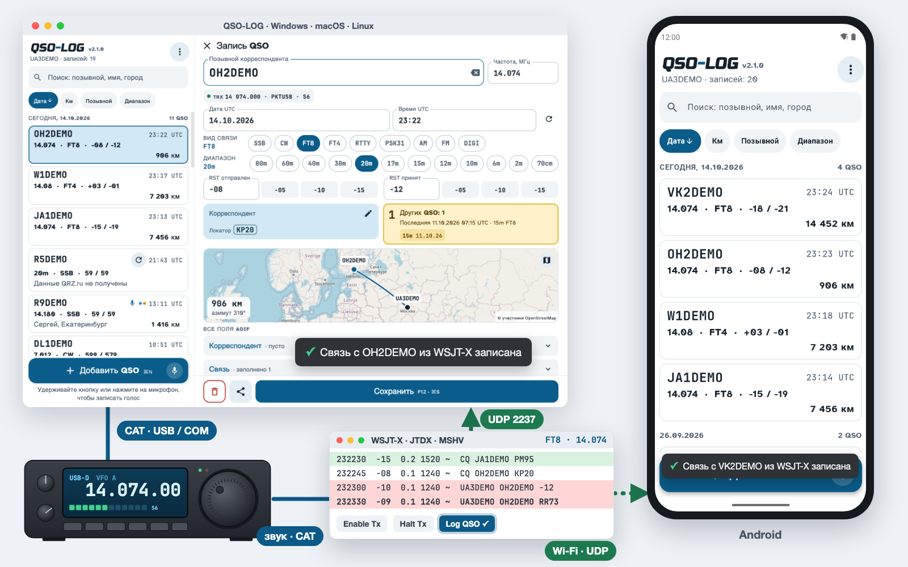
</p>

## Скачать

| Система | Версия | Файл |
|---|---|---|
| Android 8.0 и новее | 2.7.0 | [QSO-LOG-2.7.0.apk](../../releases/tag/v2.7.0) |
| macOS 11 и новее, процессор Apple (M1 и новее) | 2.7.0 | [QSO-LOG-2.7.0-macos-arm64.dmg](../../releases/tag/desktop-v2.7.0) |
| macOS 11 и новее, процессор Intel | 2.7.0 | [QSO-LOG-2.7.0-macos-x64.dmg](../../releases/tag/desktop-v2.7.0) |
| Windows 10 и 11, 64 бит | 2.7.0 | [QSO-LOG-2.7.0-windows-x64.zip](../../releases/tag/desktop-v2.7.0) |
| Linux: Ubuntu 22.04+, Debian 12, Mint | 2.7.0 | [QSO-LOG-2.7.0-linux-amd64.deb](../../releases/tag/desktop-v2.7.0) |

Как установить: [Android](#android) · [macOS](#macos) · [Windows](#windows) · [Linux](#linux).
Есть и [страница программы](https://vladkondratyev.github.io/qso-log/), она сама предложит файл для вашей системы.

## Содержание

- [Первый запуск](#первый-запуск)
- [Новая связь](#новая-связь)
- [CAT — трансивер](#cat--трансивер)
- [Телеграф (CW) с клавиш F1–F8](#телеграф-cw-с-клавиш-f1f8)
- [Цифровые виды — WSJT-X, JTDX, MSHV](#цифровые-виды--wsjt-x-jtdx-mshv)
- [Режим соревнований](#режим-соревнований)
- [Работа с клавиатуры](#работа-с-клавиатуры)
- [Журнал](#журнал)
- [Дашборд](#дашборд)
- [История поиска](#история-поиска)
- [Данные о корреспонденте](#данные-о-корреспонденте)
- [Голосовые заметки](#голосовые-заметки)
- [Расстояние и карты](#расстояние-и-карты)
- [Экспорт и импорт](#экспорт-и-импорт)
- [Онлайн-журналы: LoTW, eQSL, Club Log, QRZ.com](#онлайн-журналы-lotw-eqsl-club-log-qrzcom)
- [Синхронизация через Google Таблицу](#синхронизация-через-google-таблицу)
- [Справочник и калькуляторы](#справочник-и-калькуляторы)
- [Настройки](#настройки)
- [На компьютере](#на-компьютере)
- [Установка](#установка)
- [Где хранятся данные](#где-хранятся-данные)
- [Что пока не так](#что-пока-не-так)
- [Для разработчиков](#для-разработчиков)

## Первый запуск

Программа спросит две вещи: ваш позывной и где вы находитесь. Вместо QTH-локатора можно написать
город, локатор найдётся сам. Любой шаг можно пропустить и заполнить потом в настройках. Учётные записи QRZ.ru
и QRZ.com (для имени и города корреспондента) подключаются потом в настройках — карточка связи сама подскажет.

После обновления программа один раз показывает, что нового в этой версии.

После этого внизу экрана появится кнопка «Добавить QSO». С неё начинается каждая связь.

<p>
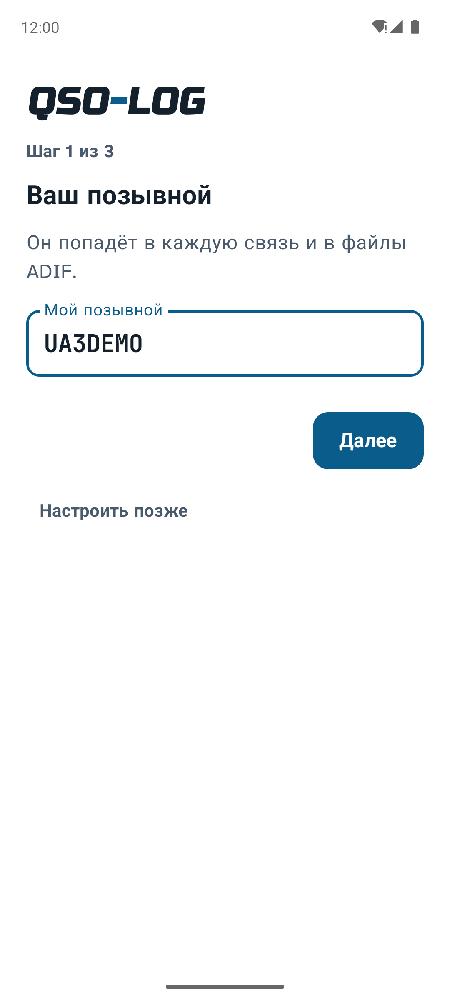
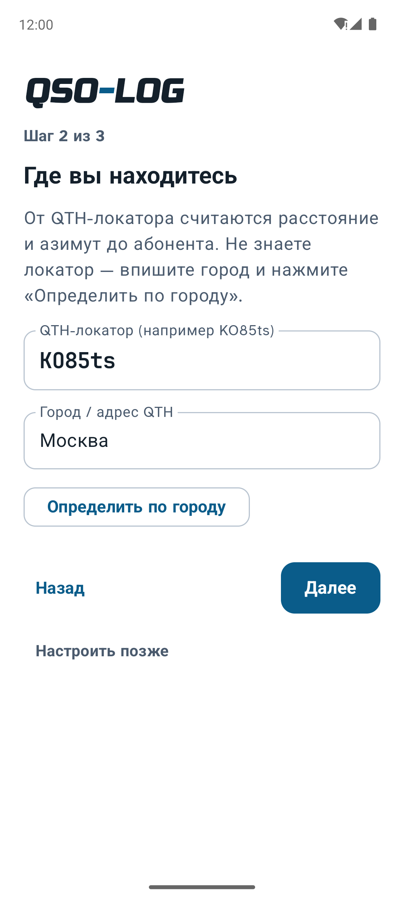
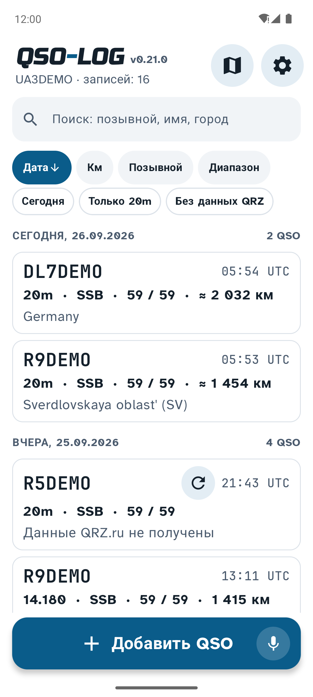
</p>

## Новая связь

Карточка открывается сразу с курсором в поле позывного. Дата и время UTC ставятся сами. Вид связи, диапазон
и частота берутся из прошлой связи, так что обычно остаётся ввести позывной и RST.

Что помогает при вводе:

- Со второй буквы под полем появляются позывные из вашего журнала. Можно выбрать, а не набирать целиком.
- С четвёртой буквы программа ищет корреспондента на QRZ.ru (и на QRZ.com) и заполняет имя, город и локатор.
- Жёлтая плашка показывает, сколько раз вы уже работали с этим позывным и когда последний раз. Если связи были
  на разных диапазонах, ниже идут компактные отметки «40m 25.09.26 · 20m 07.10.26» — последняя связь на каждом
  диапазоне; диапазон открытой карточки обведён.
- Красная плашка «Повтор» появляется, если сегодня уже была связь с ним на том же диапазоне и виде.
  Пригодится в соревнованиях.
- Частоту можно вводить в килогерцах: 14195 превратится в 14.195 МГц. Диапазон по частоте выберется сам.
- Для RST открывается цифровая клавиатура, а под полем есть кнопки частых отчётов: 59, 57, 599, −10 и так далее.
- «＋ Следующая» сохраняет связь и сразу открывает новую карточку на той же частоте. Удобно в пайлапе.
- ⌫ справа в поле позывного стирает его целиком (то же в поле поиска журнала).

Остальные поля ADIF спрятаны в раскрывающиеся группы: корреспондент, связь, моя станция, прохождение. Время связи
можно брать в момент открытия карточки или в момент сохранения, это выбирается в настройках. На телефоне с
включённым «Фиксировать время сохранения карточки QSO» в новой карточке идут часы с секундами — пока станцию зовут
в пайлапе, время не застывает; у сохранённой связи время всегда из журнала.

В сохранённой связи внизу три кнопки: удалить, отправить (текстом и с голосовой заметкой, в мессенджер или почту)
и сохранить.

<p>
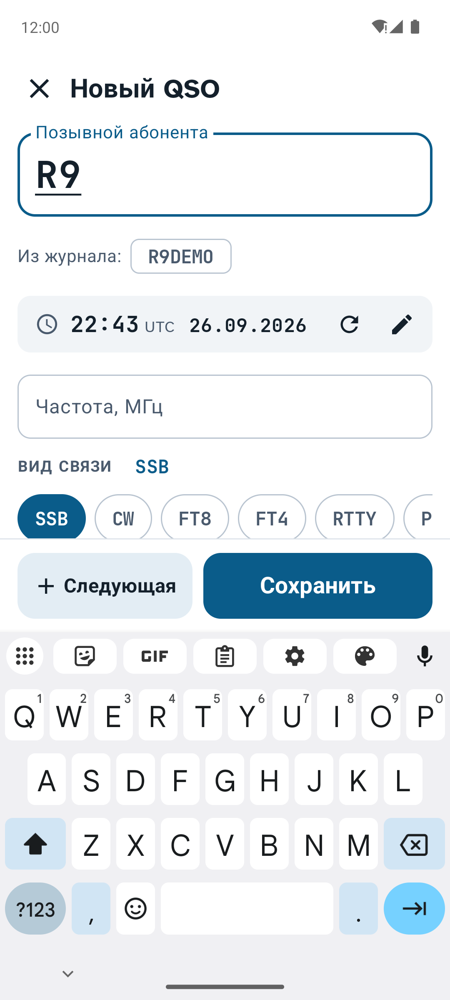
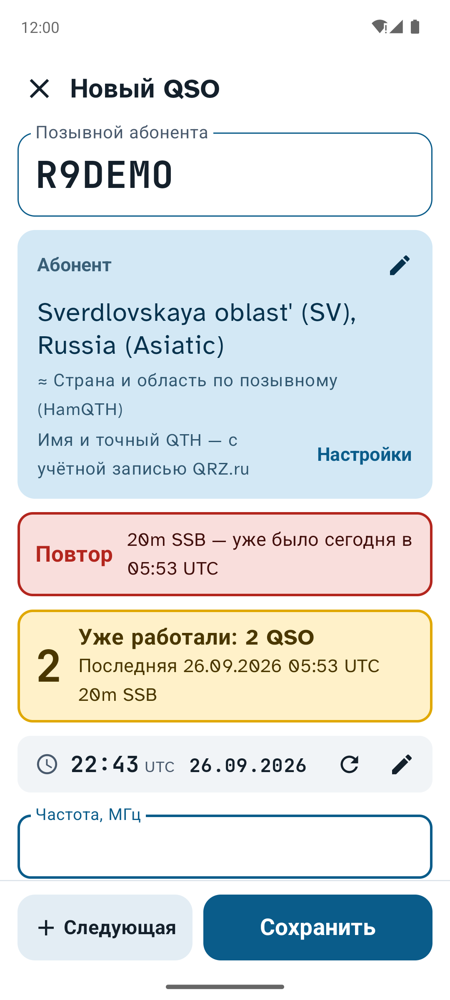
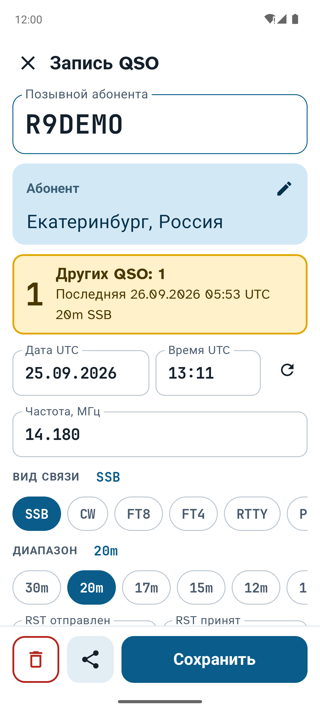
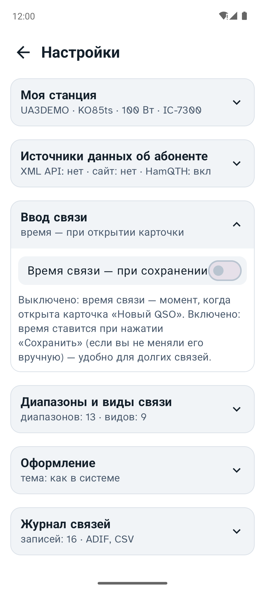
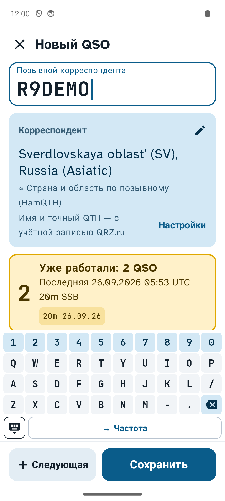
</p>

### Своя клавиатура

Вместо системной клавиатуры можно включить свою, как в контестовых программах: крупные клавиши с цифрами
и латиницей, «/», «-», «.» для частоты и ⌫. Ею набираются позывной, частота и RST, а кнопка под клавишами
переводит к следующему полю: позывной → частота → RST отправлен → RST принят. Имя, город и комментарий
по-прежнему вводятся системной клавиатурой, своя на это время прячется.

Клавиатура бывает обычной и компактной — компактная на треть ниже, и карточке остаётся больше места.
Выбирается в настройках, раздел «Ввод связи»: «Системная», «Своя», «Своя компактная». Выбор запоминается
и действует и в обычной карточке, и в режиме соревнований.

Жесты: провести пальцем по клавиатуре влево и, не отрывая, обратно вправо — стереть всё поле, где стоит курсор. Нажать и удержать
палец — клавиши бледнеют, и клавиатура становится тачпадом: ведите палец в сторону, курсор ходит между буквами,
как при удержании пробела на iPhone; следующая клавиша вставит букву в это место. Время удержания (0,2–1,5 с)
настраивается там же, в «Ввод связи».

Когда включён [телеграф](#телеграф-cw-с-клавиш-f1f8) и карточка в виде CW, над цифрами появляется ещё один ряд
(с версии 2.7.0): **F1–F8** — сообщения, **−** и **+** — скорость, **■** — остановить передачу.

<p>
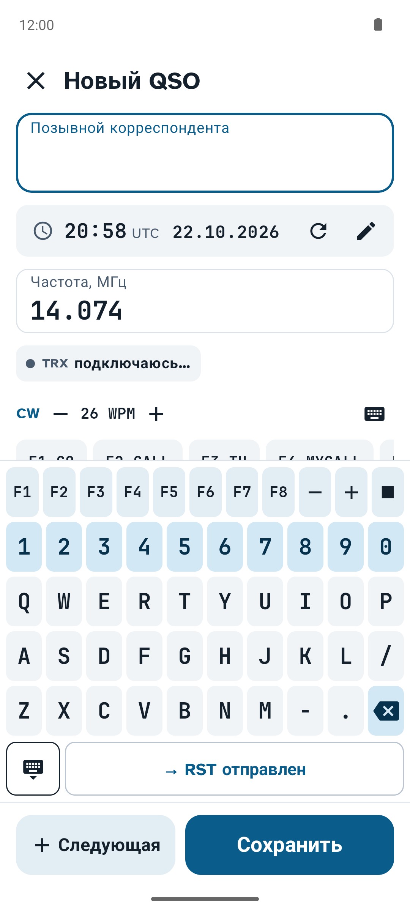
</p>

## CAT — трансивер

QSO-LOG связывается с трансивером так же, как N1MM, Log4OM, WSJT-X или FT8CN: несколько раз в секунду спрашивает
частоту, вид связи и S-метр. Пока открыта новая карточка, частота, диапазон и вид связи меняются вслед за ручкой
трансивера; по желанию и цифра S в отправленном RST берётся с S-метра (59 → 57). Поле, исправленное вручную,
трансивер в этой карточке больше не трогает, сохранённые связи не меняются. В карточке и в журнале видна строка
«TRX 14 195.000 · USB · S8».

**Пульт трансивера** (с версии 2.2.0) открывается нажатием на эту строку, из меню ⋮ или клавишей **Ctrl+T**, одинаково
на телефоне и на компьютере. На пульте крупная частота — её можно вести пальцем или мышью влево-вправо, как ручку
настройки, крутить колесом мыши или менять кнопками ± с шагом 10 Гц, 100 Гц, 1 или 10 кГц; поле для частоты
(«14195» или «7.074»); кнопки диапазонов и видов. Диапазон возвращает трансивер туда, где он был на нём в последний
раз (а в первый раз — на частоту вызова: CW, SSB или FT8). SSB сам становится LSB ниже 10 МГц и USB выше, FT8 и FT4
включают режим данных (USB-D) и переводят трансивер на частоту вида. Кнопки диапазона и вида в новой карточке QSO,
а также частота, набранная вместо позывного («14025», затем Enter), тоже перестраивают трансивер — это можно
выключить в настройках CAT.

**Шкалы** (с версии 2.3.0). На пульте под частотой — S-метр на приёме, а на передаче мощность, КСВ и ALC (у ICOM и
через Hamlib rigctld; Kenwood и Yaesu показывают только, что идёт передача). Ниже — шкала диапазона: участки CW,
узкополосной цифры, маяков и SSB по плану IARU разными цветами, частоты FT8 и FT4 и красная стрелка там, где сейчас
трансивер. Нажмите на шкалу или ведите по ней — трансивер перестроится туда.

В эфир программа сама ничего не передаёт: линии DTR и RTS порта CAT держит выключенными. Цифровые виды трансивер
не различает, поэтому в режиме DATA (USB-D) остаётся FT8, FT4 или другой цифровой вид из карточки.

Настройки → «Оборудование и программы» → **«CAT — трансивер»** (или долгое нажатие на плашку TRX): модель, способ подключения, скорость порта и адрес CI-V (если трансивер не ответит
по заданному адресу, программа сама переберёт заводские), что брать в карточку. Строка состояния показывает, что
трансивер отвечает прямо сейчас.

| Трансиверы | Протокол |
|---|---|
| ICOM: IC-705, IC-7300, IC-7610, IC-9700, IC-905, IC-7100, IC-7851, IC-7800, IC-7700, IC-7600, IC-7410, IC-7200, IC-9100, IC-7000, IC-756PRO, IC-746PRO, IC-910H, IC-718, IC-706MKIIG, IC-703, IC-R8600 и другие | CI-V (адрес задаётся вручную) |
| Xiegu X6100, X6200, G90, X5105, X108G | совместимый с CI-V |
| Kenwood TS-590, TS-890, TS-990, TS-480, TS-2000; Elecraft K3, K4, KX2, KX3; FlexRadio (SmartSDR CAT) | Kenwood |
| Yaesu FT-991, FT-891, FT-710, FTDX10, FTDX101, FTDX3000, FT-950, FT-450 | Yaesu, новый CAT |
| Yaesu FT-817, FT-818, FT-857, FT-897 | Yaesu, старый 5-байтный CAT |
| любой трансивер, который знает Hamlib | rigctld по сети (а также wfview, SDR++, flrig) |
| любой трансивер, подключённый к DXLab Commander (Windows) | директивы Commander по сети, порт 52002 |
| ICOM с сетью: IC-705, IC-7610, IC-7760, IC-9700, IC-905 и другие | сеть Icom (как RS-BA1 и wfview), UDP 50001 |
| любой трансивер, настроенный в OmniRig (Windows) | OmniRig, Rig 1 или Rig 2 |

Подключение:

- **Телефон** — USB-кабель трансивера через переходник OTG (у ICOM с USB-разъёмом напрямую, у остальных — кабель
  CI-V/CAT с адаптером CP210x, FTDI, CH340 или PL2303; Android спросит разрешение на USB-устройство), **Bluetooth**
  (трансивер или адаптер, сопряжённый в настройках Android, профиль SPP — например, IC-705) или **сеть** (rigctld,
  DXLab Commander, сетевой CAT-адаптер, ser2net).
- **Компьютер** — **COM-порт** (USB-кабель трансивера или интерфейс CAT/CI-V; для некоторых нужен драйвер CP210x,
  FTDI или CH340) или **сеть**.

**JTDX, WSJT-X и QSO-LOG с одним трансивером** (с версии 2.4.0). COM-порт может открыть только одна программа,
поэтому раньше приходилось выключать CAT в журнале. Теперь QSO-LOG сам делится трансивером: включите в настройках
CAT «Делиться трансивером: сервер Hamlib rigctld». QSO-LOG держит порт, а JTDX, WSJT-X, MSHV, GridTracker подключаются
к нему как к rigctld: в JTDX — Settings → Radio → Rig «Hamlib NET rigctl», Network Server `127.0.0.1:4532`,
PTT Method «CAT», Split Operation «None» или «Fake It». Программа ставит частоту и вид и включает передачу, QSO-LOG
при этом показывает частоту, пульт и шкалы. Если программа закроется посреди передачи, QSO-LOG вернёт трансивер на
приём. С переключателем «Пускать программы с других компьютеров сети» JTDX на компьютере может работать и с
трансивером, подключённым к телефону. Отдельный Hamlib rigctld (Настройки → «Оборудование и программы» → «Запускать вместе с QSO-LOG» →
«Добавить Hamlib rigctld») нужен, только если JTDX должен работать без QSO-LOG.

**DXLab Commander** (с версии 2.6.0) — дополнение к Hamlib для тех, у кого трансивер уже подключён к DXLab Suite на
Windows. В списке трансиверов выберите «DXLab Commander», адрес — компьютер с Commander (на нём же — `127.0.0.1`),
порт 52002 (в Commander: Configuration → Radio → Net Serv, база 52000 + 2). QSO-LOG берёт у Commander частоту, вид и
состояние передачи, а пульт, кнопки карточки и шкала диапазона перестраивают трансивер через него — вместе с DXKeeper,
WinWarbler и другими программами DXLab. S-метра и шкал мощности через Commander нет. Hamlib rigctld и встроенные
драйверы остаются как были.

**ICOM по сети** (с версии 2.7.0). IC-705, IC-7610, IC-7760, IC-9700, IC-905 и другие ICOM с сетевым разъёмом или Wi-Fi
подключаются напрямую, без компьютера рядом с трансивером, — тем же протоколом, что RS-BA1, wfview и SDR-Control
(UDP, порты 50001–50003). В меню трансивера: Network → **Network Control — ON**, **Network User1** — имя и пароль
(права Administrator), Control Port — 50001. В QSO-LOG: модель ICOM, подключение «Сеть» → «Сеть Icom (LAN, Wi-Fi)»,
адрес трансивера, порт 50001, те же имя и пароль. Так работает и в домашней сети, и в сети, которую раздаёт сам IC-705;
автопоиск по сети не нужен. Если вход не удался, программа говорит почему: трансивер не отвечает, неверные имя
или пароль, трансивер занят другой программой. Вариант «TCP-адаптер» остался для CI-V через ser2net или Wi-Fi-адаптер.

**Kenwood TS-590S/SG, TS-890S, TS-990S** (с версии 2.7.0) отвечают по CAT, только пока компьютер держит включённой
линию RTS (аппаратное управление потоком RTS/CTS); для этих моделей QSO-LOG включает её сам, для остальных — переключатель
«Держать линию RTS включённой» в настройках CAT. Если Kenwood или Yaesu молчит, программа сама перебирает скорости порта
и запоминает ту, на которой трансивер ответил.

**OmniRig** (с версии 2.7.0, Windows). Если трансивер уже настроен в OmniRig, выберите в списке «OmniRig» и Rig 1 или
Rig 2 — QSO-LOG берёт частоту, вид и передачу у OmniRig и перестраивает трансивер через него, вместе с MixW, JTDX и
другими программами, работающими через OmniRig.

<p>
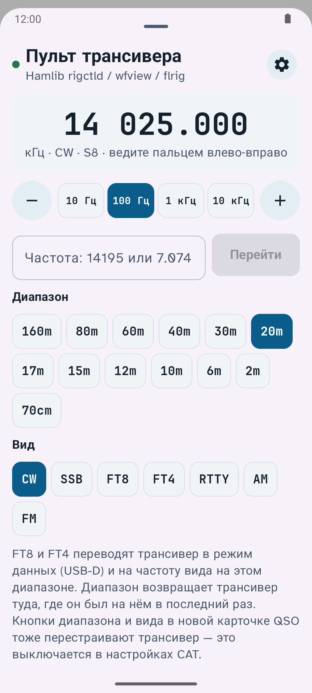
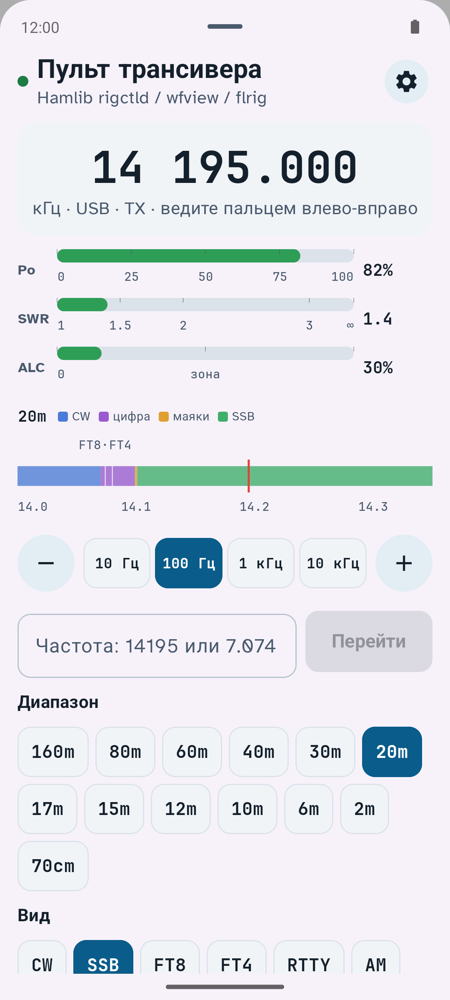
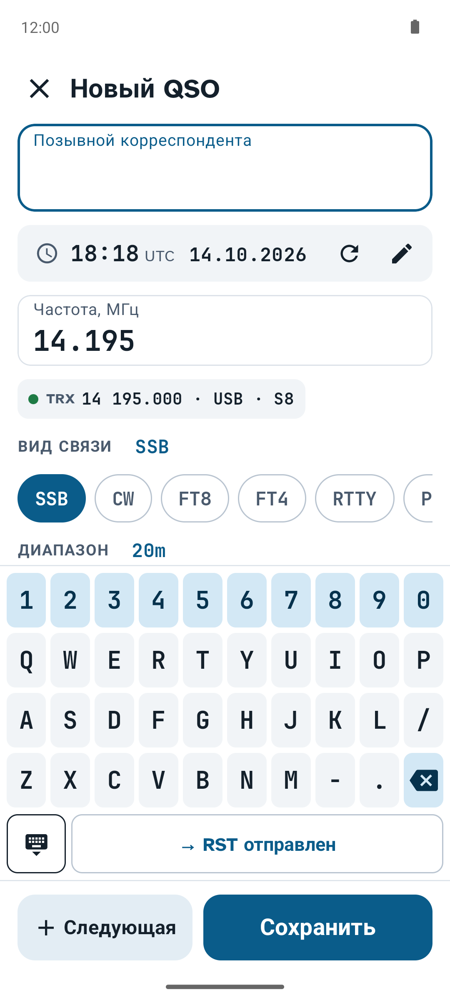
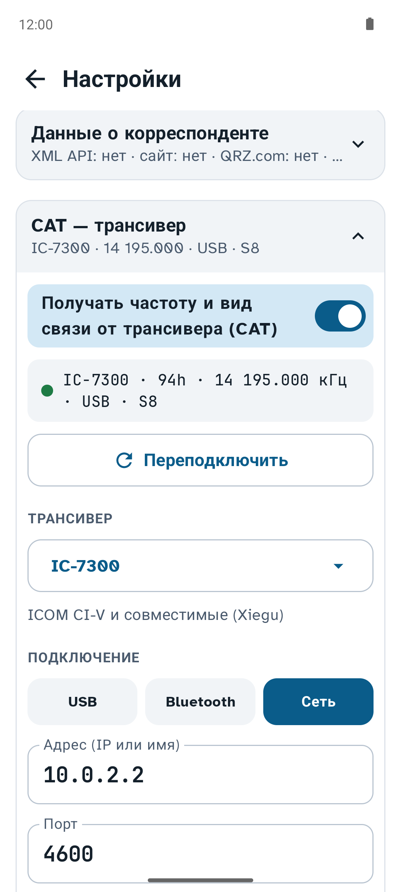
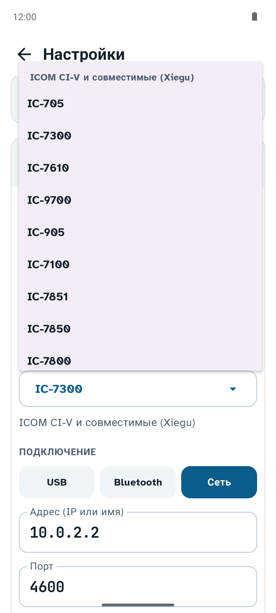
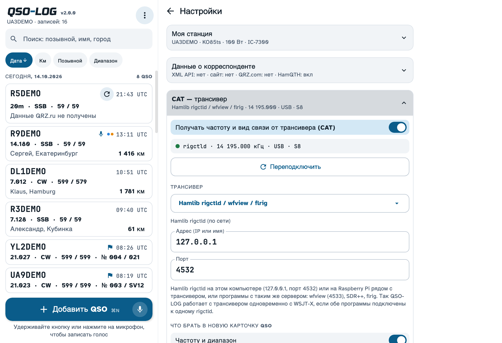
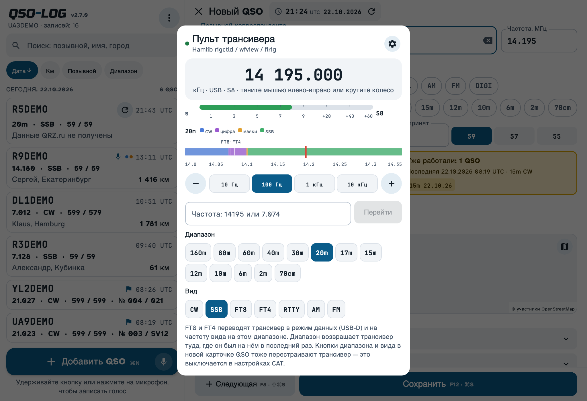
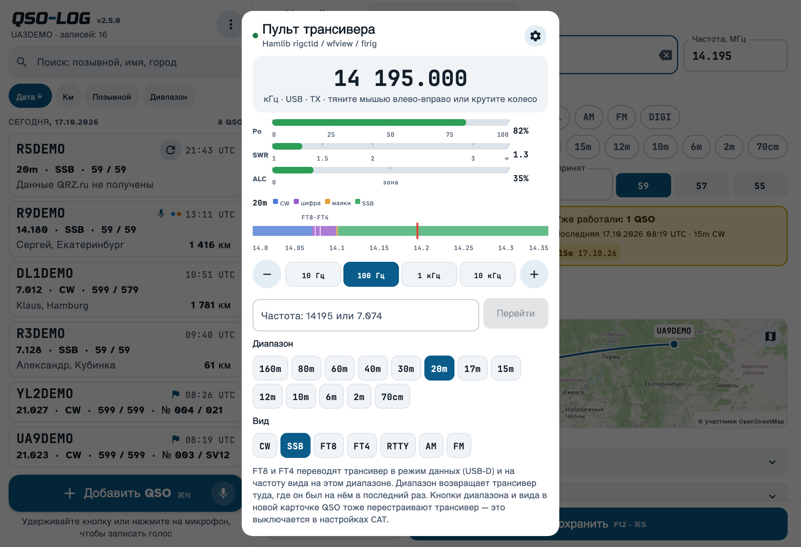
</p>

## Телеграф (CW) с клавиш F1–F8

Как в N1MM: QSO-LOG передаёт телеграфом заготовленные сообщения, замыкая ключ линией DTR или RTS USB-адаптера
(CP2102, CH340, FTDI). Восемь сообщений на клавишах **F1–F8** — CQ, обмен, «TU», свой и чужой позывной, повтор, «?»,
«AGN?»; в них подставляются поля карточки: `{MYCALL}`, `{CALL}`, `{RST}`, `{NR}` (контрольный номер отправленный),
`{NAME}`, `{MYLOC}`. Клавиши работают, когда в карточке QSO (обычной или контестной) выбран вид CW; на телефоне без
клавиатуры те же сообщения — кнопками под частотой. **Esc** останавливает передачу, **PageUp / PageDown** (или
**Alt+↑ / Alt+↓**) меняют скорость (10–50 WPM). Клавиши можно переназначить.

**Ключ на внешней клавиатуре** (с версии 2.7.0) — телеграфный ключ можно не носить с собой. В настройках CW выберите
«Прямой ключ» или «Ямбический A/B», и пока карточка QSO в виде CW, клавиши внешней клавиатуры работают ключом:
левый Ctrl или `[` — точка, правый Ctrl или `]` — тире (так же шлют USB-адаптеры манипуляторов вроде Vail), в режиме
прямого ключа ключ замкнут, пока клавиша нажата. Клавиши для ямбического и прямого ключа переназначаются там же,
в настройках CW: «Назначить» и нажмите нужную клавишу. Скорость — та же, что у сообщений. Карточка не меняется: только когда в ней начинают работать ключом, под
кнопками сообщений появляется лента — переданные знаки, у каждого его точки и тире. «Звук самоконтроля через динамик»
в настройках CW — телефон или компьютер пищит вместе с ключом, если самоконтроля трансивера не слышно. cwdaemon
принимает только текст: ему уходят готовые буквы.
В Windows манипуляция стала чёткой: длительности точек и тире больше не зависят от грубого таймера системы.

Настройки → «Оборудование и программы» → **«Телеграф (CW) — DTR/RTS или cwdaemon»**: адаптер (на телефоне — через OTG), линия ключа, скорость, тексты
сообщений, «Вторая линия — PTT» для трансиверов без полного дуплекса (break-in) и кнопка «Проверить: передать VVV».
Если CAT идёт через тот же адаптер (один кабель CP2102 и для CI-V, и для ключа), выберите его и здесь — порт будет общим.

**Xiegu G90** и другие трансиверы, у которых ключ замыкается на массу: у CP2102 выводы DTR и RTS при передаче
опускаются в 0 В. Соедините вывод с «точкой» (или прямым ключом) гнезда KEY через транзистор или оптрон (PC817),
массу — с массой, в меню трансивера выберите прямой ключ (Straight). Если ключ замкнут без передачи, включите
«Инвертировать линию ключа».

**Телеграф по сети — cwdaemon** (с версии 2.6.0). Если трансивер подключён к другому компьютеру (Linux, Raspberry Pi),
на нём работает [cwdaemon](https://github.com/acerion/cwdaemon) (`sudo apt install cwdaemon`, запуск, например,
`cwdaemon -d ttyUSB0 -p 6789`), а QSO-LOG на ноутбуке или телефоне передаёт ему сообщения F1–F8 и скорость по сети
(UDP, порт 6789) — как tlf и другие логгеры. В настройках CW выберите «cwdaemon по сети» и укажите адрес компьютера
(`192.168.1.20` или `имя:порт`). Esc останавливает передачу, Alt+↑ / Alt+↓ меняют скорость; когда cwdaemon закончит
сообщение, он сообщает об этом, и строка «идёт передача» в карточке гаснет. Знаки «+», «-» и «~» cwdaemon понимает как
команды скорости и паузы, поэтому в сообщениях они пропускаются.

<p>
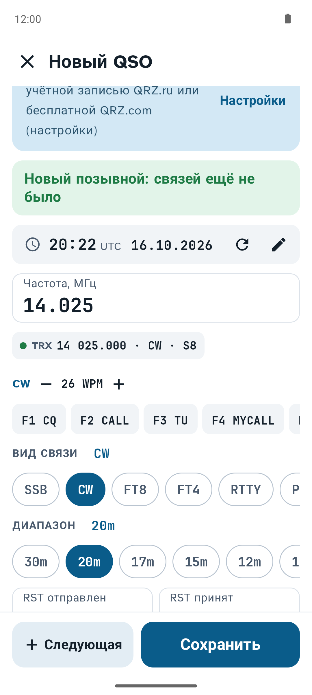
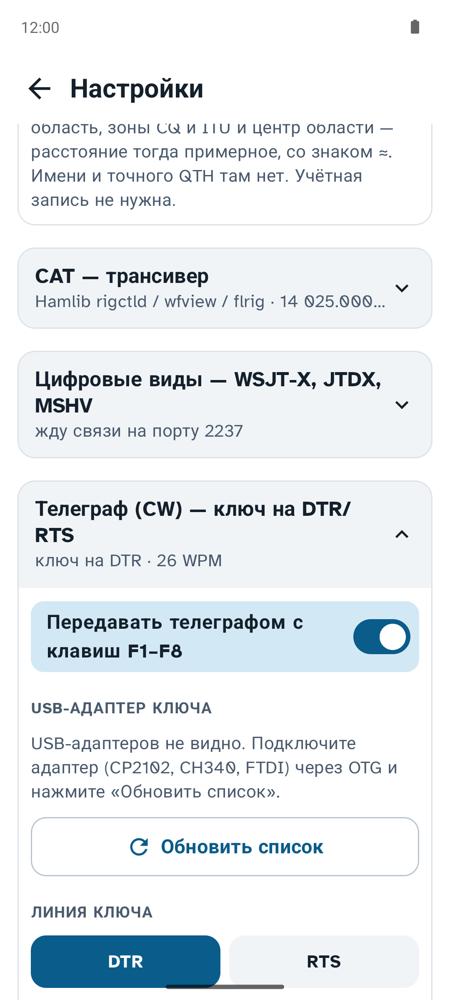
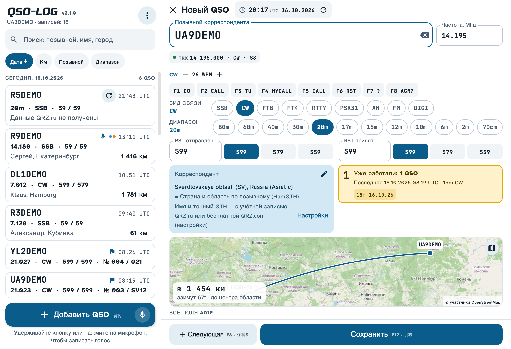
</p>

## Цифровые виды — WSJT-X, JTDX, MSHV

FT8, FT4 и другие цифровые виды проводят в WSJT-X, JTDX или MSHV. Эти программы после каждой связи отправляют её
по сети (UDP, порт 2237), и QSO-LOG записывает её в журнал сам: позывной, время начала и конца, частоту, вид связи
(FT8, FT4, JT65, Q65, MSK144…), отчёты в дБ, локаторы обеих станций. Имя и QTH программа затем берёт с QRZ.ru, как
для обычной связи. Повторы не записываются: WSJT-X сообщает о связи дважды (полями и строкой ADIF), в журнал она
попадает один раз. Принимается и простой ADIF по UDP.

Настройки → «Оборудование и программы» → **«Цифровые виды — WSJT-X, JTDX, MSHV»** → «Принимать связи». Строка состояния показывает, слышна ли
программа («порт 2237 · слышно WSJT-X v2.7.0»).

- **Компьютер.** В WSJT-X: Settings → Reporting → UDP Server — `127.0.0.1`, порт `2237`. Связь записывается, когда вы
  нажимаете OK в окне «Log QSO». В JTDX и MSHV — те же поля в их настройках.
- **Телефон.** WSJT-X на компьютере в той же сети Wi-Fi шлёт связи на адрес телефона — он показан в этом же блоке
  настроек. Связи принимаются, пока QSO-LOG запущен.
- Если порт 2237 уже слушает другая программа (JTAlert, GridTracker), укажите в WSJT-X групповой адрес (multicast),
  например `224.0.0.1`, и тот же адрес в QSO-LOG — связи получат все программы.
- **Частота и вид из JTDX** (с версии 2.2.0). Если CAT в QSO-LOG не подключён, а трансивером управляет JTDX или
  WSJT-X, программа берёт частоту и вид из их сообщений по тому же порту UDP: в карточке и в журнале видна строка
  «JTDX 14 074.000 · FT8», новая карточка следует за ней. Перестраивать трансивер тогда может только JTDX;
  чтобы управлять им и из QSO-LOG, подключите обе программы к Hamlib rigctld (см. [CAT](#cat--трансивер)).

<p>
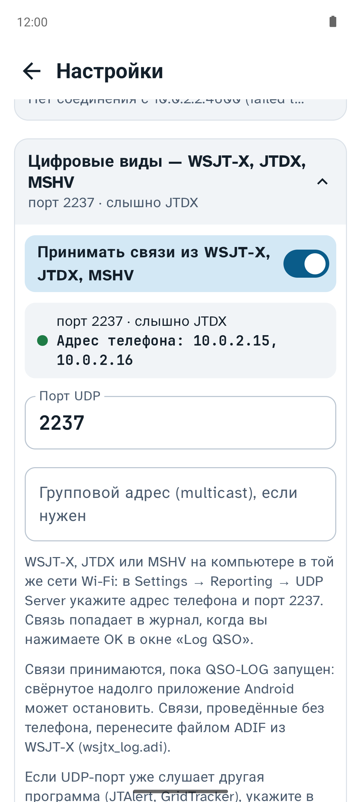
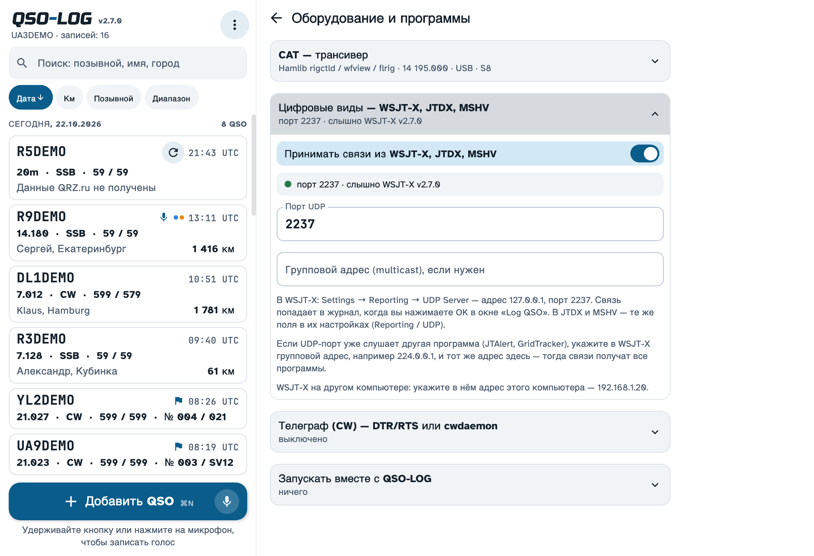
</p>

## Режим соревнований

В соревнованиях важна скорость, поэтому есть отдельный режим. Он включается переключателем в меню ⋮ (под «Справкой и калькуляторами») —
**CONTEST MODE** (то же — в настройках, блок «Соревнования», и Ctrl+K с клавиатуры). При каждом запуске программы режим снова выключен, чтобы случайно не вести
в нём обычный журнал. Пока режим работает, в шапке журнала написано «CONTEST» и что вы передаёте.

Под переключателем выбирается, что передавать каждому корреспонденту:

- **Порядковый номер** — уходит как 001, 002… и после каждой записанной связи увеличивается на единицу.
  Задаётся номер следующей связи.
- **Постоянный код** — одинаковый в каждой связи: район, область, зона (MO69, EU, 16).

- **Обмен QTH-локаторами** (УКВ-соревнования, с версии 2.4.0) — в карточке появляются «Мой локатор» и «Локатор
  корр.». Свой берётся из «Моей станции»; если работаете с выезда, впишите его в карточке — он останется для
  следующих связей. Локатор корреспондента программа подставит сама, если связь с ним уже была (в предыдущем туре
  или раньше в журнале), и QRZ.ru его не перепишет. Под полями видно расстояние до корреспондента. В отчёте ЕРМАК /
  Cabrillo локаторы идут после контрольных номеров: `… 59 005 LO65FR RA9DEMO 59 017 MO06HU`.

<p>
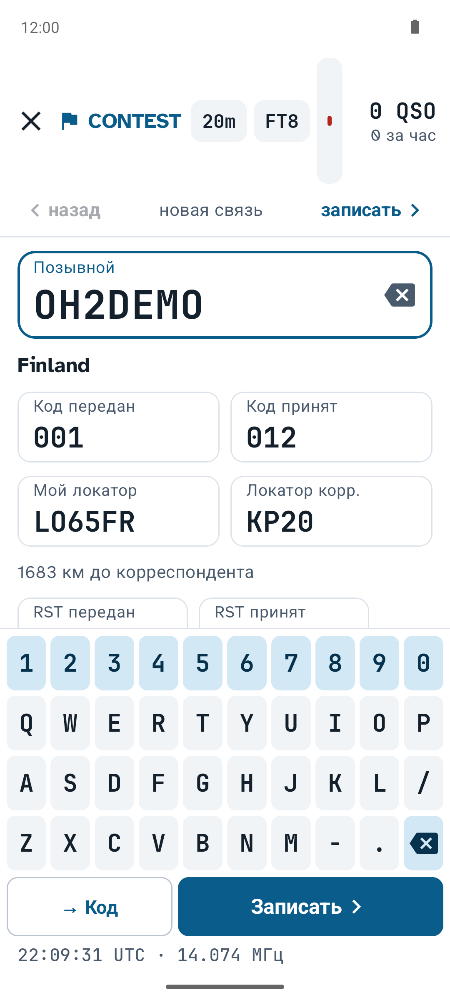
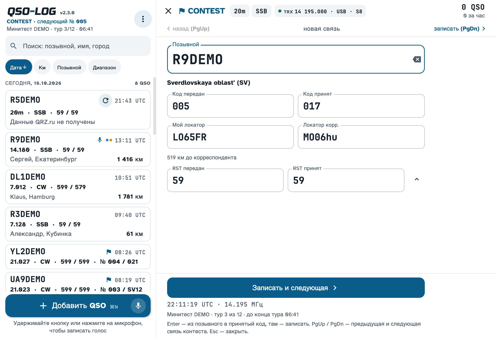
</p>

«Добавить QSO» в этом режиме открывает упрощённую карточку: позывной, под ним код передан и код принят,
ниже RST. Принятый код может быть любым: 015, MO69, EU, ABCD, 20. RST подставляются сами (59 или 599);
их можно свернуть в одну строку «RST 59 / 59», чтобы не занимали место. Диапазон и вид связи видны в шапке
и меняются нажатием; выбранный диапазон остаётся и для следующих связей. Имя, область и отметка о повторе
показываются одной строкой под позывным.

Внизу карточки — [своя клавиатура](#своя-клавиатура) с крупными клавишами: цифры, латиница, «/» для
переносных позывных, «-» для отчётов в дБ и ⌫ (если держать, стирает знак за знаком). Системная клавиатура не открывается.
Как ввести связь быстрее всего:

1. Наберите позывной и нажмите «→ Код».
2. Наберите принятый код и нажмите «Записать». Связь записана со временем UTC этого момента,
   и сразу открыта следующая карточка с новым номером.

Пока набираете позывной, под ним появляются похожие позывные из журнала — нажмите, чтобы подставить.
После записи на месте «новая связь» коротко написано «✓ позывной записана», а связь появляется в списке
«Последние связи» под карточкой; нажатие на строку открывает её для исправления. В шапке — сколько связей
сделано и сколько за последний час, внизу идут часы UTC.

Если позывной уже был на этом диапазоне и виде связи, кнопка «Записать» после первого нажатия становится
красной — «Записать повтор»: случайный повтор не попадёт в отчёт, а нужный записывается вторым нажатием.

Нажатие на заполненный код или RST выделяет его: следующая клавиша заменяет значение целиком. Второе нажатие
на активное поле выделяет и его содержимое — например, чтобы стереть позывной одним нажатием ⌫. Если удобнее
системная клавиатура, выберите её в настройках («Ввод связи» → «Клавиатура в карточке»): тогда «Далее» на клавиатуре переводит
курсор из позывного в «Код принят», а «Готово» записывает связь.

Без принятого кода связь не запишется: судейская программа такую связь всё равно не засчитает.

Свайп справа налево делает то же, что «Записать». Свайп слева направо возвращает к предыдущим
связям соревнования, чтобы исправить ошибку; обычные записи журнала при этом не открываются. Начатая,
но не записанная карточка не теряется: она снова появится, когда вы долистаете вперёд. Те же переходы есть
на кнопках «‹ назад» и «вперёд ›».

В журнале такие связи отмечены флажком, а рядом с RST видны коды: «№ 005 / 042» — передан и принят.
Коды хранятся в стандартных полях ADIF `STX_STRING` и `SRX_STRING`, из них же их берёт отчёт ЕРМАК или Cabrillo.

На компьютере своей клавиатуры в карточке нет, вместо свайпов — клавиши: Enter переводит из позывного
в «Код принят» и там записывает связь, PgUp и PgDn листают связи соревнования, Esc закрывает карточку.

<p>
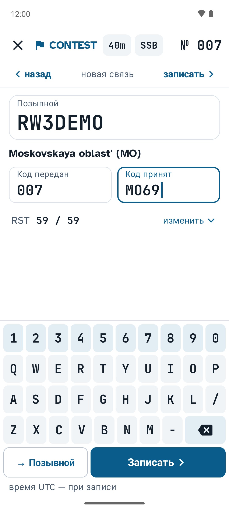
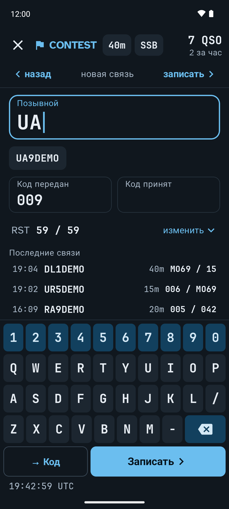
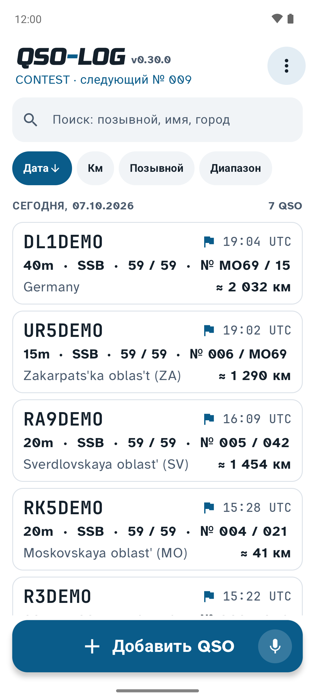
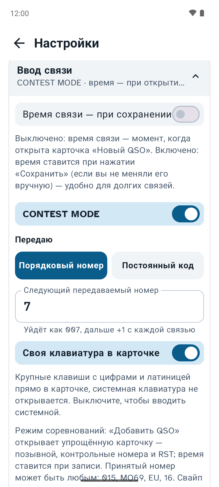
</p>

### Справочник контестов

Пока CONTEST MODE включён, в меню ⋮ есть пункт **«Справочник контестов»**. Там заводится каждое соревнование,
в котором вы работаете:

- **Название** и **код** CONTEST из положения (RDXC, R3X-CHAMP…) — код попадёт в заголовок отчёта ЕРМАК/Cabrillo.
- **Начало и конец** по UTC.
- **Туры** для минитестов: длительность тура в минутах и их количество (например, 12 туров по 10 минут).
  Конец тогда можно не указывать — он считается по последнему туру.
- **«Обнулять повторы с новым туром»** — в каждом туре с той же станцией можно снова работать.

Выбранное соревнование отмечено кружком; «Без соревнования» — как раньше. Каждая связь из карточки соревнований
получает отметку соревнования, его код (поле ADIF `CONTEST_ID`) и номер тура. В шапке журнала и под кнопками
карточки видно соревнование, текущий тур и таймер до его конца; счётчик связей и темп считаются только по этому
соревнованию. Повтором считается связь с той же станцией на том же диапазоне и виде во всём соревновании,
а с обнулением — только в текущем туре.

При экспорте в ЕРМАК/Cabrillo с галочкой «Только связи контест-режима» можно выбрать соревнование: в файл попадут
только его связи, а код CONTEST подставится сам.

<p>
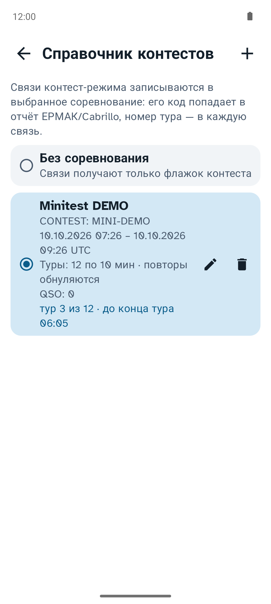
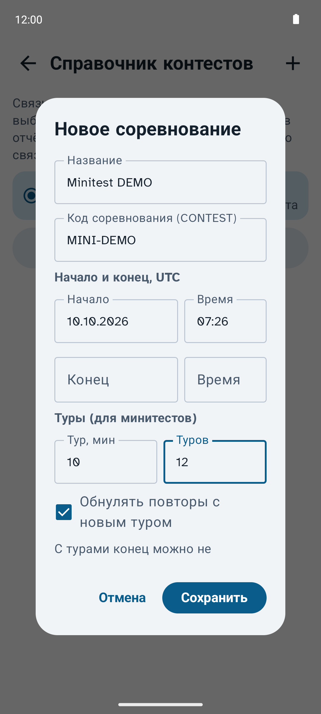
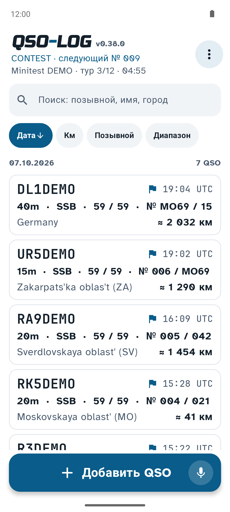
</p>

## Работа с клавиатуры

Весь выезд или контест можно провести, не касаясь экрана: на компьютере — с обычной клавиатуры, на телефоне
или планшете — с внешней (Bluetooth или USB OTG). Удобно в поле: телефон на подставке, маленькая клавиатура
на коленях. Когда внешняя клавиатура подключена, своя экранная клавиатура программы прячется, а курсор сразу
стоит в позывном.

Все сочетания ниже — по умолчанию: любое можно заменить своим в Настройки → «Интерфейс» → «Назначить
клавиши» (с версии 2.2.0). Список клавиш (F1) показывает уже ваши.

Как в классических логгерах (на телефоне с версии 0.40.0, на компьютере с 2.0.0): **Пробел** ходит по полям по кругу: позывной → RST
отправлен → RST принят → снова позывной (в контесте RST пропускается: позывной ↔ принятый код). **Enter** из любого
поля, и из позывного тоже, записывает связь и открывает новую карточку. **Alt+W** или **Ctrl+Esc** — быстрый сброс
карточки, если корреспондент ушёл в QSB: позывной, данные и рапорты очищаются, курсор — в позывном. **Esc**
закрывает карточку (если что-то введено, спросит; Enter — закрыть). **Ctrl+D** в сохранённой связи или на записи
журнала (или **Delete**) — удалить, Enter в окне подтверждения. На кнопке «Добавить QSO» при подключённой клавиатуре
написано «Ctrl+N · F9». Ошиблись в букве — **↑** в пустом позывном открывает только что записанную связь, Enter
сохраняет её и возвращает к новой карточке.

Клавиши по экранам. На macOS вместо Ctrl — ⌘.

**Везде**

| Клавиша | Что делает |
|---|---|
| Ctrl+N или F9 | новая связь |
| Ctrl+E | исправить последнюю записанную связь |
| Ctrl+F | поиск по журналу; Enter в поиске — новая связь с найденным, ↓ — к списку |
| Ctrl+H | история поиска |
| Ctrl+D · Ctrl+M · Ctrl+, | дашборд (Ctrl+D на выбранной записи — удалить её) · карта QSO · настройки |
| Ctrl+K | CONTEST MODE: включить или выключить |
| Ctrl+R | синхронизировать с Google Таблицей |
| Ctrl+Shift+E | экспорт журнала в ADIF |
| F1 (на Android и Ctrl+/) | список всех клавиш |

**Журнал**

| Клавиша | Что делает |
|---|---|
| ↑ ↓ | по записям (выбранная обведена) |
| PgUp · PgDn · Home · End | на 10 записей, к первой, к последней |
| Enter | открыть запись |
| Пробел · Ctrl+A | отметить запись · отметить все (для экспорта) |
| Delete · Ctrl+D | удалить запись или отмеченные: окно спросит, Enter — удалить (потом можно отменить) |
| Esc | снять отметки |

**Карточка связи**

| Клавиша | Что делает |
|---|---|
| Пробел | по кругу: позывной → RST отправлен → RST принят → позывной (у контест-связи: позывной ↔ код принят) |
| Enter | из любого поля — записать; в новой карточке — записать и открыть следующую |
| Tab · Shift+Tab | следующее и предыдущее поле |
| ↑ | в пустом позывном — исправить последнюю связь |
| Alt+W · Ctrl+Esc | очистить новую карточку (диапазон, вид и частота остаются), курсор — в позывной |
| Esc | закрыть карточку (с изменениями — спросит, Enter — закрыть) |
| Ctrl+D | удалить сохранённую связь (Enter — подтвердить) |
| F2 · F3 · F4 · F5 | к позывному, частоте, RST отправлен, RST принят |
| F6 | текущее время UTC |
| F7 | голосовая заметка: начать или остановить |
| F8 (на Mac и ⇧⌘S) | сохранить и открыть следующую |
| F12 (на Mac и ⌘S) | сохранить |
| Alt+1…9 · Alt+Shift+1…9 | диапазон · вид связи (n-й из включённых) |
| Shift+Enter | новая строка в комментарии |

**Режим соревнований**

| Клавиша | Что делает |
|---|---|
| Пробел | позывной ↔ принятый код (RST пропускается) |
| Enter · F12 | записать связь из любого поля |
| ↑ · PgUp | предыдущая связь (↑ — в пустом позывном) |
| PgDn | следующая связь |
| Alt+W · Ctrl+Esc | очистить карточку |
| Esc | закрыть карточку |

**История поиска**

| Клавиша | Что делает |
|---|---|
| ↑ ↓ · Enter | по записям · открыть с картой |
| Пробел · Ctrl+A | отметить запись · отметить все |
| F | в избранное или из избранного |
| E | изменить (отмеченные — все сразу) |
| N | новый QSO с этой станцией |
| M | все на карте или списком |
| Delete | удалить из истории |
| Esc | назад |

**Дашборд**: 1 · 2 · 3 · 4 — 7 дней, 30 дней, год, всё время; Esc — назад.

На маленьких клавиатурах без F-клавиш выручают команды прямо в поле позывного. Вместо позывного наберите
команду и нажмите Enter или Пробел — программа переключит диапазон, вид связи или частоту и очистит поле:

| Набрать | Что произойдёт |
|---|---|
| `20m` или `20`, `70cm` или `70` | диапазон |
| `CW`, `SSB`, `FT8`, `FM`… (`USB` и `LSB` — тоже SSB) | вид связи |
| `14195` или `14.195`, `7074` | частота в килогерцах или мегагерцах, диапазон выберется сам |

С позывным такая команда не спутается: в позывном всегда есть и буквы, и цифры.

Весь список — первая вкладка справки **«Клавиши»** и кнопка **«Список клавиш»** в настройках, блок
«Ввод связи»; на телефоне оба открываются и без подключённой клавиатуры. В меню ⋮ есть пункт «Клавиши» (на телефоне —
когда клавиатура подключена), а сочетания видны прямо в пунктах меню. На Mac F-клавиши нажимаются вместе
с fn, если в настройках клавиатуры не включено «Использовать F1, F2 и т. д. как стандартные функциональные клавиши».

<p>
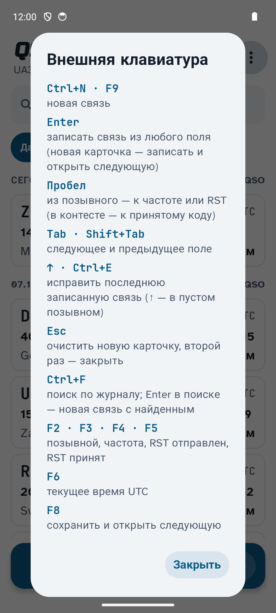
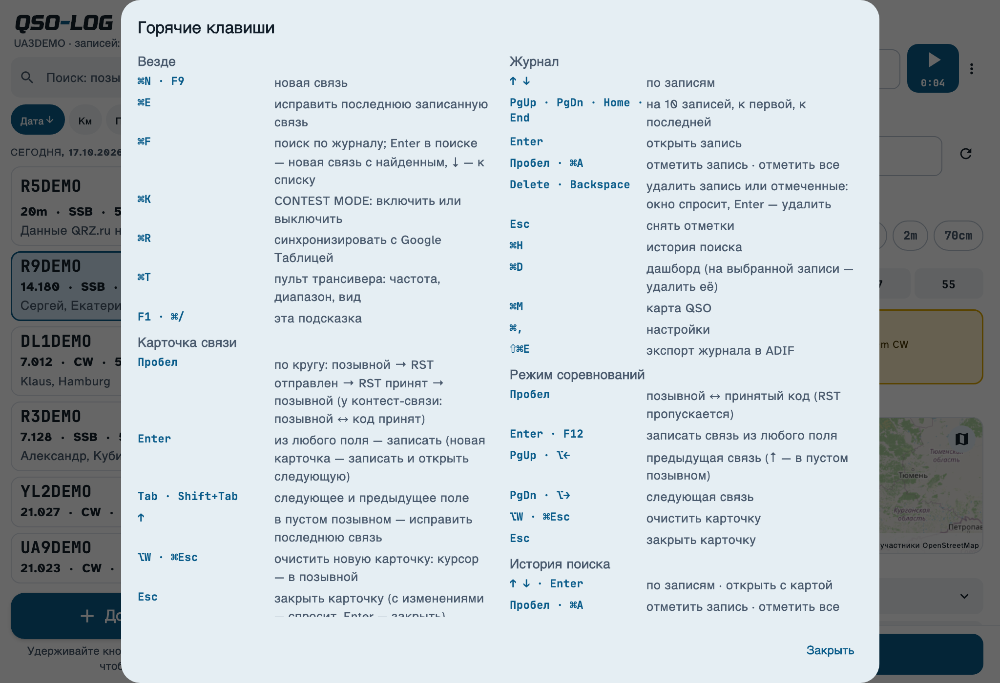
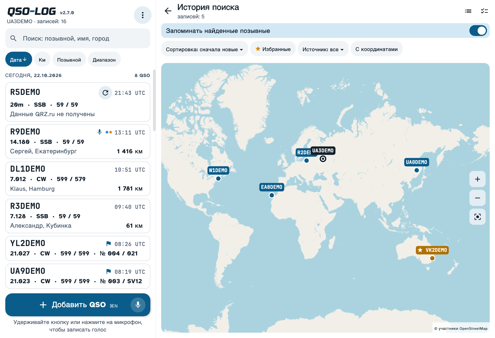
</p>

## Журнал

Связи сгруппированы по дням, свежие сверху. В строке видно позывной, время, частоту, вид, RST, расстояние,
имя и город. Значок микрофона значит, что у связи есть голосовая заметка.

- **Поиск** работает по позывному, имени, городу, локатору и комментарию. Если такого позывного в журнале нет,
  программа поищет его на QRZ.ru и сразу откроет новую карточку с найденными данными.
- Если поиск нашёл одного знакомого корреспондента, под строкой поиска видно, на каких диапазонах с ним уже есть
  связи и когда была последняя на каждом. «Добавить QSO» откроет карточку уже с его именем и городом.
- **Сортировка**: по дате, расстоянию, позывному или диапазону. Второе нажатие на ту же кнопку меняет порядок.
- Связь, сохранённая без интернета, помечена кнопкой ⟳. Нажмите её, когда сеть появится, и данные с QRZ.ru допишутся.
- Несколько связей выбираются долгим нажатием (на компьютере ещё Ctrl-щелчком или ⌘-щелчком).
  Выбранные можно выгрузить в файл кнопкой «Экспорт». Кнопка-фильтр рядом выбирает записи за период, на нужных
  диапазонах и видах (с версии 2.5.0).
- Удалить связь можно только из её карточки. Программа переспросит, а после удаления ещё можно нажать «Отменить».
- Кнопка «⋮» в правом верхнем углу открывает меню, разложенное по группам: дашборд, карта QSO и история поиска;
  «Экспорт и импорт…» и синхронизация; справка и калькуляторы; переключатель CONTEST MODE (и справочник контестов,
  когда режим включён); внизу настройки.

<p>
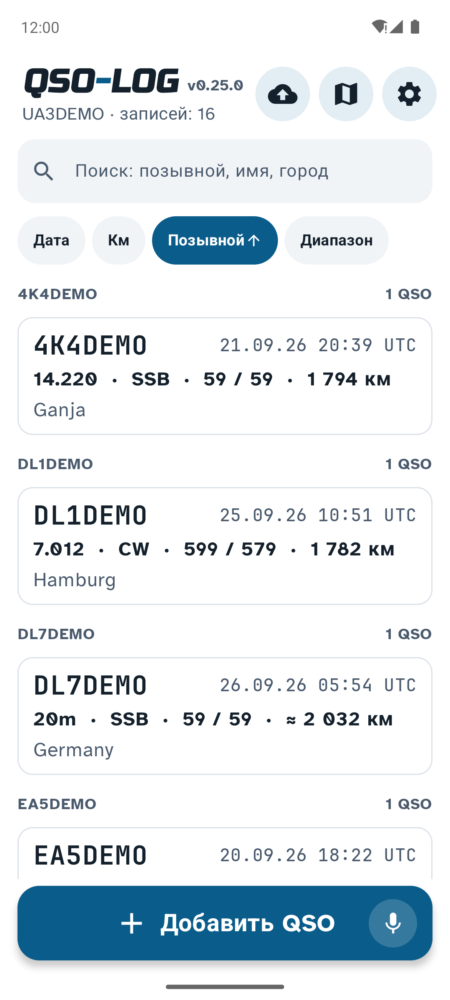
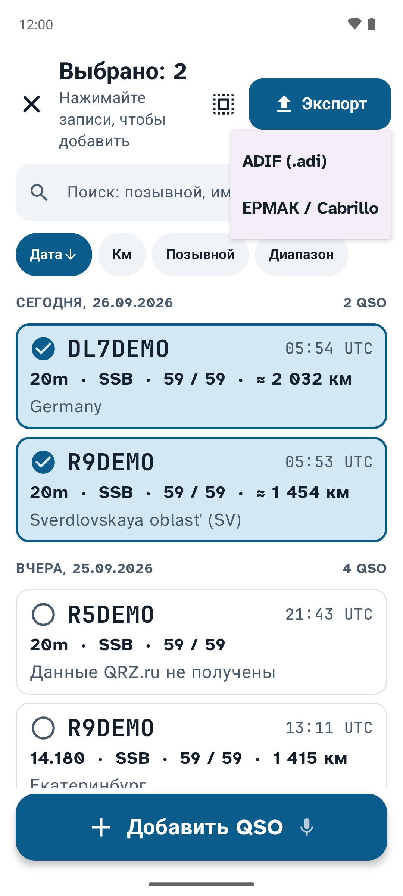
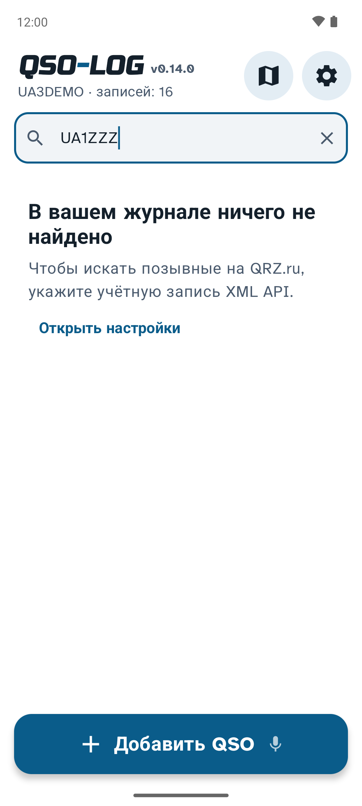
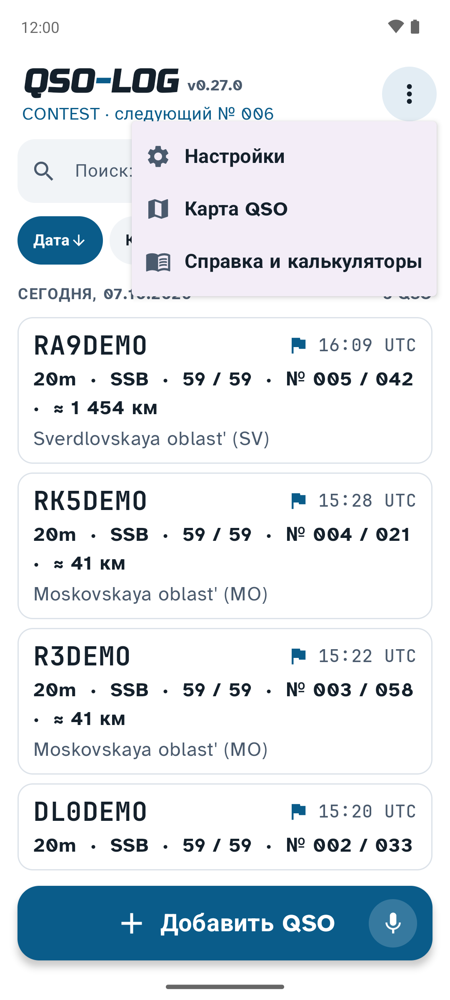
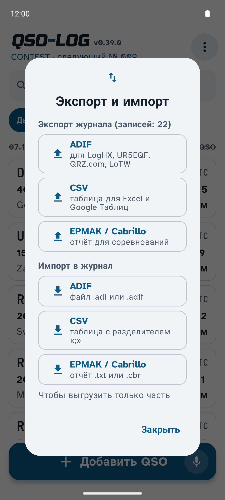
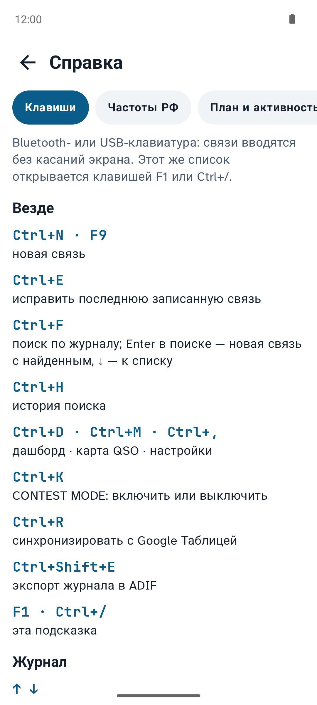
</p>

## Дашборд

Статистика журнала в графиках: меню «⋮» → «Дашборд». Всё считается на телефоне, без интернета.

Сверху одна строка параметров, они действуют на все графики сразу:

- период: 7 дней, 30 дней, год или всё время;
- диапазон и вид связи: все или какой-то один;
- «Контест» — только связи [режима соревнований](#режим-соревнований) (кнопка видна, если такие связи есть).

Что показывает дашборд:

| Блок | Что там | Формы |
|---|---|---|
| Сводка | QSO, разных позывных, стран DXCC и континентов, активных дней и среднее за день, рекорд дня, самая дальняя связь | числа |
| Связи по времени | сколько связей по дням, неделям или месяцам (выбирается сам или вручную), пустые дни тоже видны | столбцы, линия, нарастающий итог, столбцы с разбивкой по диапазонам |
| Диапазоны | связи на каждом диапазоне, по порядку частот | полосы или кольцо с долями |
| Виды связи | SSB, CW, FT8… | полосы или кольцо с долями |
| Когда вы в эфире | тепловая карта: день недели × час UTC | — |
| Чаще всего | 10 позывных, с кем больше всего связей | полосы |
| Страны | все страны DXCC журнала: связи, разных позывных, континент, диапазоны, последняя связь; по числу связей, по алфавиту или недавние | список с полосами |
| Континенты | по префиксу позывного, по справочнику cty.dat | полосы |
| Расстояние | сколько связей до 100 км, 100–500 км и так далее до 10 000 км и дальше | полосы |

Нажатие на столбец, точку или клетку показывает точное число. Графики в цветах программы: основной — фирменный
синий QSO-LOG, дальше янтарный, зелёный, фиолетовый и розовый. Цвета закреплены за значением: самый частый
диапазон журнала остаётся синим при любом фильтре. Палитра проверена на различимость при нарушениях цветового
зрения, в светлой и тёмной теме.

<p>
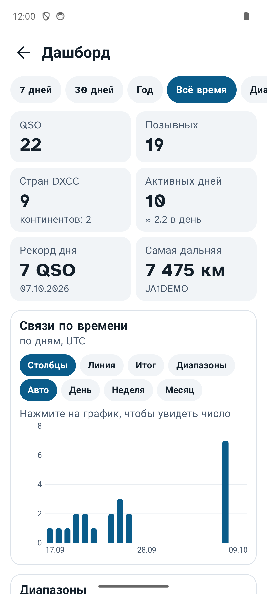
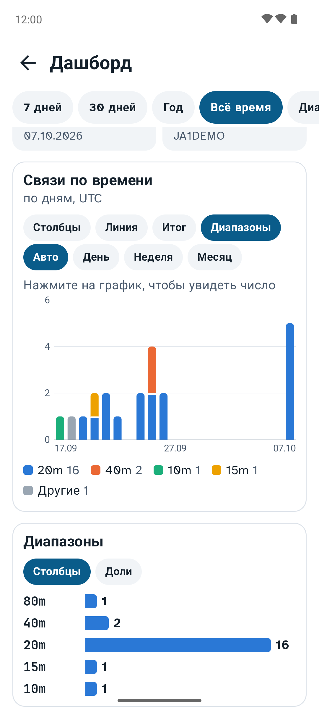
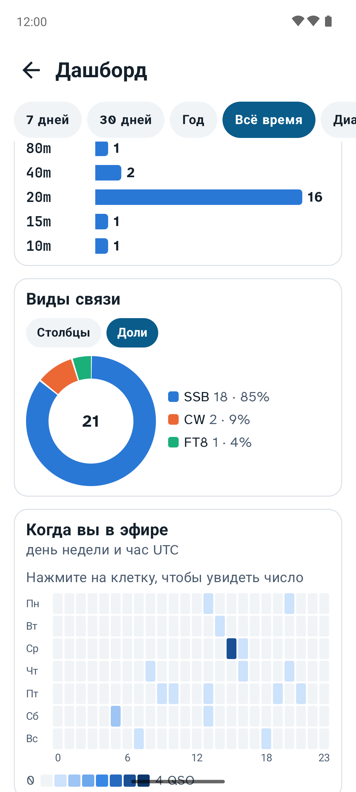
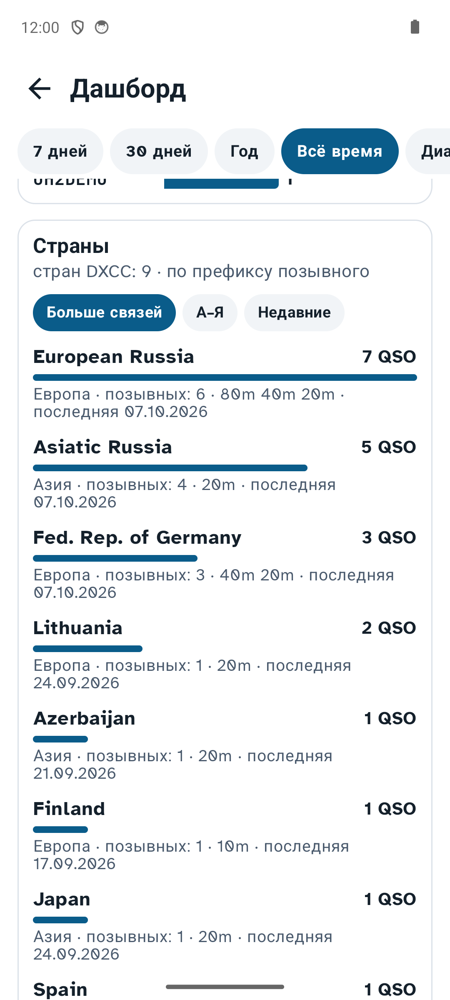
</p>

## История поиска

Меню ⋮ → «История поиска». Сюда сами попадают все позывные, которые вы искали — в поиске журнала или в карточке
«Новый QSO». Это кэш поиска: связи из него не появляются и в подсчёте QSO он не участвует. Если со станцией уже есть
связи, в строке написано «в журнале: N QSO». У каждой записи видно, откуда взяты данные: QRZ.ru, сайт QRZ.ru,
QRZ.com или HamQTH, и когда.

История включается переключателем на её экране (меню ⋮ → «История поиска»); при включении программа предупредит, для чего
она нужна. Главное — работа без интернета: если QRZ.ru или QRZ.com не отвечают, карточка новой связи заполнится
из истории (в карточке будет пометка «Из истории поиска»). Записи хранятся только на устройстве.

Что можно делать:

- открыть запись: карта с трассой от вас до корреспондента, расстояние, азимут и обратный азимут, имя, QTH,
  локатор, RDA, зоны; кнопка «Новый QSO» создаёт связь с этими данными;
- отметить звёздочкой — избранные всегда вверху списка;
- сортировать (сначала новые, по позывному, ближе, по стране) и фильтровать: только избранные, по источнику,
  только с координатами, поиск по тексту;
- посмотреть все записи сразу на карте, избранные выделены янтарным; нажатие на метку открывает запись;
- изменить запись или сразу несколько (долгое нажатие или кнопка выбора): заполненные поля поменяются у всех
  выбранных, пустые останутся как были; удалить одну или несколько.

<p>
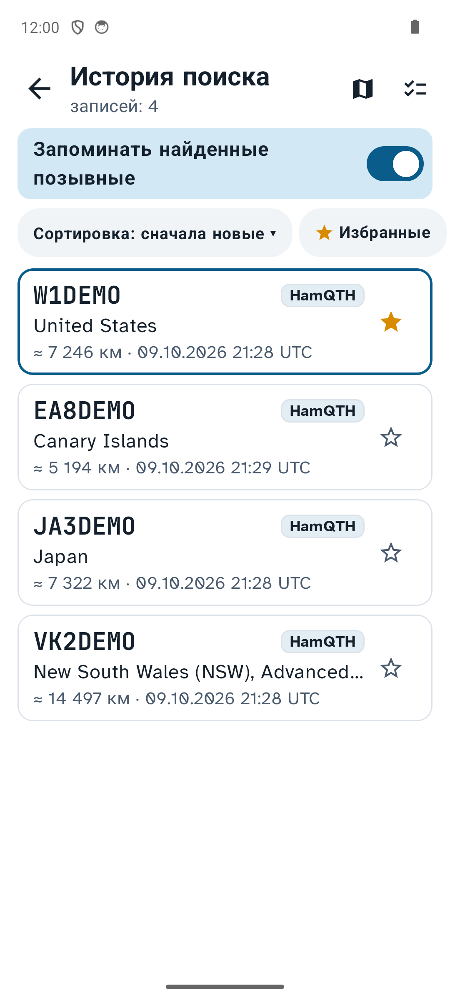
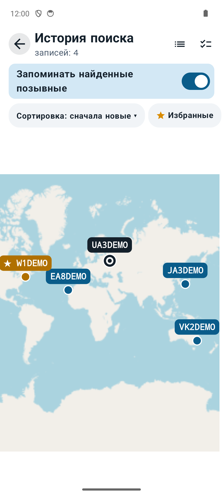
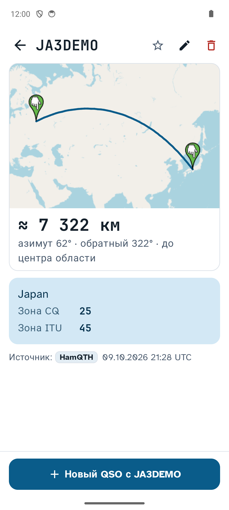
</p>

## Данные о корреспонденте

Имя, город и координаты корреспондента программа ищет в шести местах, по очереди. Все они настраиваются в одном
блоке «Данные о корреспонденте».

**1. XML API QRZ.ru.** Основной способ, так QRZ.ru предлагает подключать программы-журналы. Логин и пароль
для API выдаёт сам QRZ.ru:

1. Войдите на qrz.ru. Ваш позывной должен быть в Callbook.
2. Откройте «Личные данные», внизу раздел «XML API», кнопка «Создать аккаунт»
   ([прямая ссылка](https://www.qrz.ru/personal/settings/apiuser)).
3. Укажите позывной и название программы: QSO-LOG.
4. Логин и пароль придут через какое-то время. Это не пароль от сайта.

Доступ дают на постоянные позывные радиолюбителей и наблюдателей. Подробности в
[справке QRZ.ru](https://www.qrz.ru/help/api/xml).

XML API не отдаёт район RDA. Для российского позывного программа после ответа API открывает страницу
позывного на qrz.ru (одна страница на позывной, работает и без учётной записи сайта) и берёт оттуда район RDA
и область: они видны в карточке рядом с локатором и попадают в ADIF (`CNTY`, `STATE`).

**2. Учётная запись сайта QRZ.ru.** Запасной вариант, если доступа к API нет. Вы указываете e-mail и пароль
от qrz.ru, программа открывает страницу позывного и берёт оттуда имя, город, область и район RDA. Если указаны
и API, и сайт, сначала спрашивается API. Имейте в виду: если сайт поменяет вёрстку, этот способ сломается,
а каждый запрос засчитывается корреспонденту как просмотр его страницы.

**3. Сайт QRZ.com.** Для зарубежных позывных, которых нет на QRZ.ru. Вы указываете логин QRZ.com (позывной
или e-mail) и пароль, подойдёт бесплатная учётная запись. Программа входит на qrz.com и читает страницу позывного:
имя, город, страну, локатор, координаты и зоны CQ/ITU. QRZ.com спрашивается, если QRZ.ru позывного не знает
или не ответил. Ограничения те же, что у сайта QRZ.ru, а учётные записи с двухфакторным входом не поддерживаются.

**4. Справочник HamQTH** (с версии 2.7.0) — бесплатная учётная запись hamqth.com: имя, QTH, локатор и координаты.

**5. QRZCQ** (с версии 2.7.0) — справочник qrzcq.com; программам он отвечает только для премиум-участников.

Справочники спрашиваются по порядку. Если QRZ.ru нашёл позывной, но без QTH или координат, недостающее ищется
дальше по списку — в QRZ.com, HamQTH и QRZCQ, а имя и всё, что уже найдено, остаются из первого ответа.

**6. HamQTH по префиксу.** Работает без регистрации, но знает только страну, область и зоны CQ/ITU. Расстояние в этом случае
считается до центра области и помечается знаком «≈». Если не нужен, выключите в настройках.

Без интернета связь всё равно сохранится, данные можно будет подтянуть потом кнопкой ⟳.

<p>
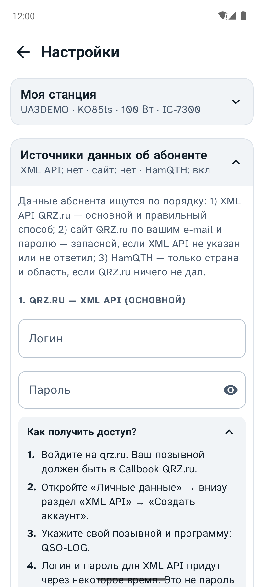
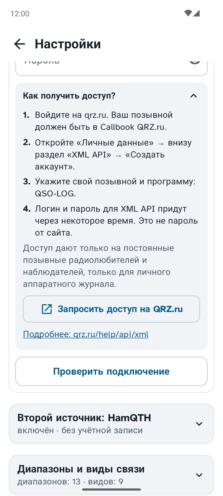

</p>

## Голосовые заметки

Иногда проще наговорить, чем набрать. Запись можно начать тремя способами:

- удерживать «Добавить QSO»: пока держите, идёт запись, отпустили — открылась карточка с заметкой;
- нажать на микрофон справа на той же кнопке, а потом нажать ещё раз, чтобы остановить;
- нажать на микрофон в заголовке новой карточки (он появляется, когда корреспондент найден на QRZ.ru).
  Запись идёт до кнопки «Стоп» или до сохранения связи.

Заметка проигрывается кнопкой ▶ рядом с позывным. В меню ⋮ её можно отправить вместе с данными связи или удалить.

<p>


</p>

## Расстояние и карты

Расстояние и азимут считаются от вашего QTH-локатора. В карточке связи под ними нарисована трасса по дуге большого
круга, кнопка «Карта» открывает её на весь экран. Если вы работаете из экспедиции, локатор можно поменять
в самой связи.

Пункт «Карта QSO» в меню «⋮» показывает всех ваших корреспондентов на OpenStreetMap. Нажатие на точку открывает
последнюю связь с этой станцией.

<p>


</p>

## Экспорт и импорт

Все форматы собраны в одном окне: меню ⋮ → **«Экспорт и импорт…»** (на компьютере — меню «Файл»; в настройках, блок
«Журнал связей», есть кнопка, открывающая это же окно). Поддерживаются три формата:

- **ADIF** (.adi) понимают LogHX, UR5EQF, HamLog, N1MM, QRZ.com и другие журналы. Через ADIF же удобно переносить
  лог между телефоном и компьютером. Кодировку файла выбираете при экспорте: UTF-8 подходит для большинства программ
  и сайтов, Windows-1251 нужна для LogHX и UR5EQF. Программа запоминает ваш выбор. При импорте (с версии 2.7.0)
  кодировка выбирается в окне: UTF-8 по умолчанию, Windows-1251, KOI8-R, CP866 (DOS), Windows-1252, ISO-8859-1, — а под
  ней видны первые записи файла: если вместо букв непонятные знаки, выберите другую. Все поля файла сохраняются, даже незнакомые.
- **CSV** открывается в Excel, разделитель — точка с запятой.
- **ЕРМАК** ([ermak.srr.ru](https://ermak.srr.ru/)) для российских соревнований и **Cabrillo 3.0** для
  международных. Перед сохранением программа спросит код соревнования, категорию и район RDA.
  Контрольные номера берутся из карточки, а если их нет, ставятся по порядку: 001, 002… Если в журнале есть
  связи [режима соревнований](#режим-соревнований), в диалоге включена галочка «Только связи контест-режима»:
  обычные записи без номеров в отчёт не попадут.

Чтобы выгрузить часть журнала (с версии 2.5.0), нажмите в окне «Экспорт и импорт» **«Часть журнала…»** (на компьютере —
«Файл» → «Выбрать часть журнала…»): период (сегодня, 7 дней, 30 дней, этот год или свои даты по UTC), диапазоны и
виды связи. Подходящие записи станут выбранными в журнале — их можно добавить или убрать нажатием — и кнопка
«Экспорт» выгрузит именно их. Связи можно выбрать и вручную, долгим нажатием. Выбранные записи выгружаются все:
«Все выбранные» стоит по умолчанию, а в ЕРМАК / Cabrillo не включается фильтр «Только связи контест-режима».

<p>

</p>

Перед сохранением программа задаёт два вопроса:

1. Брать только новые связи или все. «Новые» — это те, которые в этот формат ещё не выгружались. При выгрузке всего
   журнала по умолчанию выбраны они, так что в следующий раз не придётся искать, что уже отправлено.
2. Ставить ли в карточках отметку об экспорте.

Отметки видны в самом низу карточки связи, с датой и временем, отдельно для каждого формата. Если связь надо
выгрузить ещё раз, отметку можно снять. В журнале у выгруженных связей рядом со временем стоят цветные точки:
синяя — ADIF, зелёная — CSV, оранжевая — ЕРМАК или Cabrillo.

У каждой связи есть свой постоянный номер — GUID. Он записывается в ADIF (поле `APP_QSOLOG_UID`) и CSV (столбец `uid`),
поэтому связь, перенесённая файлом на другое устройство, остаётся той же связью. При импорте повторы пропускаются:
сначала по GUID, а для файлов из других программ — по позывному, минуте, диапазону и виду.

<p>


</p>

## Онлайн-журналы: LoTW, eQSL, Club Log, QRZ.com

С версии 2.3.0 связи выгружаются в LoTW (ARRL), Club Log и журнал QRZ.com, с версии 2.6.0 — и в eQSL: ⋮ → «Экспорт и импорт» → «Онлайн-журналы»,
или «Экспорт» у выбранных записей. В окне выбирается журнал, «только новые» (по умолчанию) или все, и ставить ли
отметку. Отметка с датой и временем видна в карточке связи, её можно снять — тогда связь уйдёт снова.

- **QRZ.com Logbook** — нужен API-ключ журнала: qrz.com → My Logbook → Settings → «API Access Key» (доступ к API
  журнала даёт подписка QRZ.com). Повторы QRZ.com не принимает, они считаются «уже были там».
- **Club Log** — e-mail и пароль учётной записи и ключ приложения: Club Log выдаёт его по запросу (Help Desk →
  «Request an API key»). Позывной берётся из «Моей станции».
- **eQSL** — логин (позывной) и пароль eQSL, и QTH Nickname, если у позывного несколько профилей. Повторы eQSL
  не принимает, они считаются «уже были там».
- **LoTW без TQSL** (с версии 2.7.0) — как в RUMlog и SDR-Control: загрузите в настройках файл сертификата `.p12`
  (в TQSL на компьютере: Callsign Certificates → ваш позывной → «Save the callsign certificate»), и связи подписываются
  прямо в QSO-LOG и уходят в LoTW по кнопке — и с телефона, и с компьютера. Позывной и страна берутся из сертификата,
  локатор — из «Моей станции», зоны CQ и ITU можно указать. Связи с другим позывным станции (например, `/P`, для
  которого нужен свой сертификат) и вне срока сертификата не подписываются, программа об этом скажет.
- **Подтверждения LoTW** (с версии 2.7.0): с логином и паролем сайта LoTW ⋮ → «Экспорт и импорт» → **«Подтверждения
  LoTW»** скачивает подтверждения с прошлой загрузки. Подтверждённые связи отмечаются (`LOTW_QSL_RCVD`, дата видна в
  карточке) и в журнале **подсвечиваются зелёным** со значком ✓.
- **LoTW через TQSL** — без файла `.p12` всё как раньше: на компьютере QSO-LOG запускает TQSL сам (укажите Station
  Location), на телефоне сохраняет файл ADIF для TQSL.

**Карточки eQSL** (с версии 2.6.0): ⋮ → «Экспорт и импорт» → **«Карточки eQSL»** загружает ящик eQSL — карточки,
которые прислали вам. Если в журнале есть связь с той же станцией (позывной с /P и без считается одним), на том же
диапазоне и виде и не дальше 30 минут по времени, в ней появляется отметка «eQSL получена» с датой карточки (она
видна в карточке связи, в блоке «Экспорт», и уходит в ADIF как `EQSL_QSL_RCVD`). Карточки, для которых связи в журнале
нет, показываются списком: отметьте нужные и нажмите «Добавить в журнал» — они станут новыми связями (принятый RST —
из карточки). Повторная загрузка ничего не дублирует.

Учётные записи — в Настройки → «Справочники и онлайн-журналы» → **«Онлайн-журналы: LoTW, eQSL, Club Log, QRZ.com»**. Пароль и ключи хранятся зашифрованно
(на телефоне — в хранилище Android, на компьютере — в связке ключей системы).

<p>

</p>

## Синхронизация через Google Таблицу

Один журнал на двух-трёх устройствах: телефон, планшет, компьютер. Связи собираются в вашей собственной
Google Таблице, программа обменивается с ней по кнопке «Синхронизировать» — сама в фоне она ничего не отправляет.

Писать в таблицу программам Google разрешает только через вход в аккаунт или через скрипт в самой таблице.
QSO-LOG использует скрипт: вход в Google в программе не нужен, а таблица остаётся вашей. Настройка — один раз,
минут пять, удобнее на компьютере:

1. Откройте свою Google Таблицу, можно новую и пустую.
2. Меню «Расширения → Apps Script». Сотрите всё в окне редактора и вставьте код скрипта. Код показан в настройках
   программы (блок «Журнал связей», раздел «Синхронизация через Google Таблицу»), кнопка «Скопировать код скрипта»
   кладёт его в буфер обмена. Тот же код лежит в репозитории:
   [qsolog-sheet-sync.gs](shared/src/main/resources/qsolog-sheet-sync.gs).
3. Нажмите «Сохранить», затем «Начать развёртывание → Новое развёртывание», тип — «Веб-приложение».
   Укажите «Запуск от имени: я» и «У кого есть доступ: все», нажмите «Начать развёртывание» и разрешите доступ
   своему аккаунту. Google предупредит, что приложение не проверено: это ваш собственный скрипт,
   нажмите «Дополнительные настройки → Перейти».
4. Скопируйте «URL веб-приложения» — он заканчивается на `/exec` — и вставьте в поле «Адрес скрипта».
   Рядом с полем есть кнопка «Вставить из буфера».
5. Нажмите «Синхронизировать». Введите тот же адрес на других устройствах и тоже нажмите «Синхронизировать».

Первая синхронизация объединяет журналы. Если одна и та же связь уже была на двух устройствах (например,
журнал переносили через ADIF), она склеивается в одну строку. Дальше нажимайте «Синхронизировать» на любом
устройстве — в настройках или в меню ⋮ журнала. Под кнопкой видно, когда была последняя синхронизация и сколько
связей отправлено и получено.

Как это устроено:

- В таблице появляется лист «QSO-LOG». В первой строке — названия полей и их описание, дальше по строке на связь.
  Все значения хранятся как текст, поэтому «001» остаётся «001», а частота не превращается в дату.
- Если связь изменили на двух устройствах, остаётся более поздняя правка.
- Связи можно править прямо в таблице: изменённая строка придёт на устройства при следующей синхронизации.
  Строку, добавленную в таблицу вручную, программа тоже заберёт.
- Связь, удалённая на одном устройстве, удаляется и на остальных. В таблице её строка остаётся с отметкой `Y`
  в столбце `deleted`. Чтобы удалить связь из таблицы, поставьте `Y` сами — строку не удаляйте, иначе устройства
  об этом не узнают.
- Голосовые заметки остаются на своём устройстве. «Удалить весь журнал» очищает только это устройство:
  при следующей синхронизации связи вернутся из таблицы.
- Адрес скрипта работает как пароль: кто его знает, может менять журнал. Открывать саму таблицу по ссылке не нужно.

<p>

</p>

## Справочник и калькуляторы

На телефоне справочник открывается из меню «⋮» в журнале: пункт «Справка и калькуляторы». На компьютере —
из того же меню «⋮» над журналом или из меню «Файл». Всё работает без интернета.

| Вкладка | Что там |
|---|---|
| Частоты РФ | любительские полосы по решению ГКРЧ № 10-07-01, от 2200 м до 250 ГГц |
| План и активность | упрощённый план IARU Region 1, частоты FT8, FT4, WSPR, SSTV, QRP, APRS, МКС; какой маяк NCDXF сейчас в эфире |
| Морзе | латиница, кириллица, цифры и знаки; нажатие на знак проигрывает его звук; у русских букв — латинская буква с тем же сигналом (W/В, Q/Щ); у русских букв, цифр и знаков — напевы для заучивания («ай-ДА», «БА-ки-те-кут», «пя-ти-ле-ти-е») |
| Позывные | фонетический алфавит ICAO и русская таблица |
| Коды | Q-коды, сокращения CW, шкала RST |
| Уровни | пересчёт Вт, dBm и dBW, расчёт ЭИИМ, шкала S-метра |
| Кабели | потери в кабеле на нужной частоте и длине, таблица затухания популярных кабелей, КСВ |
| Антенны | длина волны, диполь, GP, рамка, четвертьволновый отрезок кабеля |
| Префиксы | страна, зоны и расстояние по позывному; для России — область и код RDA |
| Прохождение | что значат SFI, A и K; часовые пояса России |

### Тренажёр азбуки Морзе

Во вкладке «Морзе» наверху режимы: «Таблица», «Текст» (на телефоне), «Передача» и «Приём».

- **Текст.** Вставьте или наберите любой текст — латиницей, кириллицей или вперемешку — и нажмите «Играть»: он
  звучит азбукой Морзе со скоростью 5–40 слов в минуту (скорость можно менять на ходу). Звучащий знак подсвечен,
  текст прокручивается за ним, а ниже бежит лента: каждый знак и его код. Нажатие на знак в ленте — играть с него.

- **Передача.** Программа показывает группу знаков, вы передаёте её ключом, а ниже появляется то, что программа
  «услышала»: верные знаки зелёным, ошибки красным. Ключ — прямо на экране (одна площадка для прямого ключа или две,
  «·» и «−», для манипулятора) или настоящий. Для манипулятора программа работает как электронный ключ, ямбический
  режим A или B. Для прямого ключа она подстраивается под ваш темп и показывает скорость. Звучит самоконтроль 700 Гц.
- **Приём** по методу Коха. Программа играет группу из пяти знаков, вы набираете, что услышали; ответ можно набирать
  в любой раскладке — K засчитывается как К. Сначала два знака, а когда последние пять групп приняты на 90%, добавляется
  новый. Ошибки показываются с сигналом и напевом. Знаки звучат на рабочей скорости, а паузы между ними можно удлинить.
- Скорость, тип ключа, алфавит (кириллица или латиница) и число выученных знаков запоминаются.

Как подключить настоящий ключ или манипулятор (например, Xiegu с разъёмом 3,5 мм). В режиме «Передача» есть кнопка
«Подключить ключ»: там те же инструкции, список подключённых переходников (на телефоне), проверка — нажимаете ключ
и видите, что пришло и как понято, — и назначение: «Назначить» и нажать ключ, так подойдёт переходник с любыми клавишами.

- **USB- или Bluetooth-переходник, который передаёт нажатия как клавиатура** (готовый, вроде Vail Adapter, или
  самодельный на плате Seeed XIAO, Arduino Pro Micro, ESP32). Точка — левый Ctrl или «[», тире — правый Ctrl или «]»,
  прямой ключ — любая из этих клавиш или Пробел. К телефону — через USB OTG, к компьютеру — в любой USB-порт.
- **На телефоне — как кнопка гарнитуры**, через гнездо 3,5 мм или переходник USB-C → 3,5 мм с микрофоном. По стандарту
  Android замыкание микрофонного контакта на землю — кнопка гарнитуры (прямой ключ), через 240 Ом — «громкость +» (точка),
  через 470 Ом — «громкость −» (тире). Задержка здесь больше, и не на всех телефонах система отдаёт эти кнопки программе.

<p>


</p>

Откуда данные: решение ГКРЧ № 10-07-01, таблица кабелей [DD1US](https://www.dd1us.de), файл стран cty.dat
от AD1C ([country-files.com](https://www.country-files.com)), список субъектов РФ с сайта
[СРР](https://srr.ru/spisok-subektov-rossijskoj-federats/). Это справочные значения. Для важных решений сверяйтесь
с документами и паспортом своего кабеля.

<p>


</p>
<p>


</p>

## Настройки

С версии 2.5.0 настройки в два уровня. На главной странице — то, что меняют часто; оборудование и учётные записи
вынесены на отдельные страницы. У каждого блока в заголовке коротко написано, что сейчас выбрано, так что раскрывать
всё подряд не нужно.

- **Моя станция**: позывной, QTH-локатор, город. Кнопка «Определить локатор» найдёт его по QRZ.ru или по городу.
  Здесь же мощность, трансивер, антенна и оператор, которые подставятся в новые связи.
- **Ввод связи**: своя клавиатура и время удержания для курсора, «Фиксировать время сохранения карточки QSO».
- **Соревнования**: [режим соревнований](#режим-соревнований) CONTEST MODE, что передаётся, обмен локаторами.
- **Диапазоны и виды связи**: какие кнопки показывать в карточке. Если оставить один диапазон или один вид,
  кнопок не будет, он просто подпишется.
- **Оборудование и программы ›** — отдельная страница: [CAT](#cat--трансивер), [цифровые виды](#цифровые-виды--wsjt-x-jtdx-mshv),
  [телеграф](#телеграф-cw-с-клавиш-f1f8) и «Запускать вместе с QSO-LOG». На телефоне — список приложений (например,
  FT8CN или программа SDR): при открытии QSO-LOG запустит их и сразу вернётся на свой экран, а они продолжат работать
  в фоне. Если телефон спрашивает разрешение или приложение не успевает открыться, выключите «Сразу возвращаться в
  QSO-LOG». На Xiaomi, Redmi и Poco нужно разрешение «Отображать всплывающие окна, когда запущено в фоновом режиме»
  (Настройки → Приложения → QSO-LOG → Другие разрешения) — с версии 2.6.0 QSO-LOG сам подсказывает это и открывает
  нужный экран кнопкой «Открыть разрешения QSO-LOG». На компьютере — любые программы с параметрами (JTDX, WSJT-X, Hamlib rigctld), уже запущенная второй раз не
  открывается, по желанию закрываются вместе с QSO-LOG. На телефоне эта страница открывается и долгим нажатием на
  плашку TRX, на компьютере — «Файл» → «Оборудование и программы…».
- **Справочники и онлайн-журналы ›** — отдельная страница: QRZ.ru, QRZ.com и HamQTH (см. [выше](#данные-о-корреспонденте))
  и учётные записи [LoTW, eQSL, Club Log и QRZ.com](#онлайн-журналы-lotw-eqsl-club-log-qrzcom).
- **Журнал связей** (в заголовке видно, включена ли синхронизация с Google): «Экспорт и импорт…», «Выбрать часть
  журнала…», [синхронизация через Google Таблицу](#синхронизация-через-google-таблицу), удаление всего журнала.
- **Интерфейс**: язык (как в системе, русский или английский — меняется сразу), тема (светлая, тёмная или как в
  системе), «Не выключать экран во время работы приложения» (телефон) и «Назначить клавиши» — любое сочетание внешней
  клавиатуры можно заменить своим, добавить второе или убрать.

В самом низу — номер версии, «Что нового», «Сообщить о проблеме» и кнопка «Проверить обновления». Если на GitHub
есть версия новее, программа покажет, что в ней изменилось, и предложит обновить. Под кнопкой — переключатель
«Автоматически проверять новую версию при запуске программы» (с версии 2.7.0 включён): при запуске программа тихо
проверяет GitHub и, если вышла новая версия, один раз показывает окно с её новыми возможностями и кнопкой «Обновить»;
закрытое окно для этой версии больше не появляется. С выключенным переключателем при запуске ничего не проверяется.
«Сообщить о проблеме» открывает
в браузере новую задачу на GitHub с заготовкой текста, версией программы и моделью устройства — журнал, позывной и
пароли туда не попадают; отправляете вы сами (нужна учётная запись GitHub).

<p>


</p>

<p>


</p>

<p>


</p>

<details>
<summary>Ещё скриншоты с телефона</summary>
<p>


</p>
</details>

Все позывные на скриншотах вида `*DEMO` выдуманы.

## На компьютере

Версия для компьютера умеет всё то же, что и Android: CAT с трансивером (COM-порт или Hamlib rigctld), связи из WSJT-X, поиск на QRZ.com,
режим соревнований, дашборд, синхронизацию через Google Таблицу. С версии 2.0.0 номера версий на телефоне и компьютере
совпадают. Окно разделено на две части: слева журнал, справа карточка связи, карта, дашборд или настройки.
С версии 1.14.0 шрифт и кнопки на компьютере примерно на 30% мельче, чем раньше: в окне помещается больше.

<p>


</p>

Связь можно ввести, не трогая мышь: все клавиши — в разделе [Работа с клавиатуры](#работа-с-клавиатуры), в программе их показывает F1.

Несколько отличий от телефона:

- Голосовые заметки пишутся в WAV (на телефоне в M4A, файлы там в несколько раз меньше).
- «Отправить» копирует данные связи в буфер обмена. Если есть заметка, она сохраняется в выбранную папку
  вместе с текстовым файлом.
- Экспорт, импорт и справочник есть ещё в меню «Файл».

<details>
<summary>Ещё скриншоты с компьютера</summary>
<p>


</p>
</details>

## Установка

Новую версию на любой системе ставьте поверх старой. Журнал и настройки сохранятся.

### Android

1. Скачайте `QSO-LOG-0.40.2.apk` со [страницы релиза](../../releases/tag/v0.40.2).
2. Откройте файл на телефоне. Android может попросить разрешить установку из этого источника — разрешите.

### macOS

1. Скачайте со [страницы релиза](../../releases/tag/desktop-v2.7.0) файл для своего Mac:
   - `QSO-LOG-2.7.0-macos-arm64.dmg`, если процессор Apple (M1 и новее);
   - `QSO-LOG-2.7.0-macos-x64.dmg`, если Intel.

   Узнать, какой у вас, можно в меню  → «Об этом Mac».
2. Откройте DMG и перетащите QSO-LOG в «Программы».
3. При первом запуске macOS скажет, что не может проверить разработчика: программа не подписана сертификатом Apple.
   Откройте «Системные настройки» → «Конфиденциальность и безопасность» и внизу нажмите «Всё равно открыть».
4. Когда вы первый раз запишете голосовую заметку, macOS спросит доступ к микрофону.

### Windows

1. Скачайте `QSO-LOG-2.7.0-windows-x64.zip` со [страницы релиза](../../releases/tag/desktop-v2.7.0).
2. Распакуйте архив целиком, например в «Документы». Прямо из архива программа не запустится.
3. Запустите `QSO-LOG.exe`. Java ставить не нужно, она уже в папке.
4. Windows может показать «Система Windows защитила ваш компьютер», потому что программа не подписана.
   Нажмите «Подробнее» и «Выполнить в любом случае».
5. Если заметки не записываются, разрешите доступ к микрофону: «Параметры» → «Конфиденциальность и защита» →
   «Микрофон» → «Разрешить классическим приложениям доступ к микрофону».

Чтобы обновить программу, замените папку. Подробнее — в `README.txt` внутри архива.

### Linux

1. Скачайте `QSO-LOG-2.7.0-linux-amd64.deb` со [страницы релиза](../../releases/tag/desktop-v2.7.0).
2. Установите двойным щелчком или из терминала:
   ```bash
   sudo apt install ./QSO-LOG-2.7.0-linux-amd64.deb
   ```
3. QSO-LOG появится в меню приложений, в разделе «Любительское радио».

Удалить: `sudo apt remove qso-log`. Журнал в домашней папке при этом останется.

## Где хранятся данные

Журнал, настройки и заметки лежат только на вашем устройстве:

| Система | Папка с журналом | Пароли QRZ.ru |
|---|---|---|
| Android | внутри приложения | зашифрованное хранилище Android |
| macOS | `~/Library/Application Support/QSO Log` | Связка ключей |
| Windows | `%APPDATA%\QSO Log` | Диспетчер учётных данных |
| Linux | `~/.local/share/qso-log` | GNOME Keyring или KWallet, если их нет — файл настроек |

В интернет программа ходит только за данными корреспондентов (api.qrz.ru, www.qrz.ru, www.qrz.com, hamqth.com), за картами
OpenStreetMap, на GitHub, когда вы проверяете обновления, и в вашу Google Таблицу (script.google.com), когда вы нажимаете
«Синхронизировать».

## Что пока не так

- Android-версия собрана для ручной установки, в Google Play её нет.
- Версии для macOS и Windows не подписаны, поэтому система предупреждает при первом запуске.
- Версию для Windows я собираю на Mac, на настоящей Windows её пока никто не проверял. Linux-версия проверена
  в Ubuntu 24.04, но без микрофона. Если что-то не работает, напишите в [issues](../../issues).
- В Linux вариант «как в системе» всегда даёт светлую тему. Тёмную можно включить вручную.
- На карте QSO подписи соседних станций при мелком масштабе накладываются.
- Голосовые заметки не попадают в файлы экспорта и между устройствами не переносятся.
- На телефоне связи из WSJT-X принимаются, только пока QSO-LOG запущен: надолго свёрнутое приложение Android может
  остановить. Пропущенные связи переносятся файлом ADIF из WSJT-X.
- Управление трансивером и телеграф проверены на имитаторах протоколов, а не на живых трансиверах всех моделей.
  Старые Yaesu со своим 5-байтным CAT (FT-840, FT-890, FT-990, FT-1000) пока не поддерживаются — к ним можно
  подключиться через Hamlib rigctld на компьютере.
- DXLab Commander проверен на имитаторе его сетевого протокола, cwdaemon — на настоящем cwdaemon 0.10 без
  трансивера. Загрузка eQSL проверена на тестовой учётной записи eQSL.

## Для разработчиков

Программа написана на Kotlin. Общая часть (журнал, форматы, расчёты, QRZ.ru, QRZ.com, HamQTH, синхронизация с таблицей, справочник,
протоколы CAT в `shared/…/cat/`, приём из WSJT-X в `shared/…/digi/`) одна для всех систем. Порт трансивера: на Android — usb-serial-for-android и Bluetooth SPP,
на компьютере — jSerialComm. Интерфейс на Android сделан на Jetpack Compose, на компьютере — на Compose Multiplatform.

- `shared/` — общий код;
- `app/` — Android;
- `desktop/` — macOS, Windows и Linux.

Нужны JDK 17 (Temurin) и Android SDK 34.

```bash
./gradlew :app:assembleRelease         # APK для Android (R8, подпись debug-ключом)
./gradlew :shared:test :desktop:test   # тесты
# синхронизация двух «устройств» через настоящий скрипт таблицы (адрес …/exec тестовой таблицы)
SHEET_SYNC_URL=https://script.google.com/macros/s/…/exec ./gradlew :shared:test --tests '*SheetSyncTest*'
./gradlew :desktop:run                 # запустить версию для компьютера
./gradlew :desktop:screenshots         # скриншоты для этого README
./gradlew :desktop:packageReleaseDmg   # DMG для своего Mac
# DMG для Intel: тот же Gradle с Temurin 17 x64 под Rosetta
JAVA_HOME=/путь/к/temurin-17-x64/Contents/Home arch -x86_64 ./gradlew --no-daemon :desktop:packageReleaseDmg
./desktop/windows/build-windows.sh     # ZIP для Windows (собирается на Mac)
./desktop/linux/build-linux.sh         # DEB для Linux (собирается на Mac в Docker)
```

## Лицензия

[MIT](LICENSE). Лицензии шрифтов, библиотек и справочных данных — в [THIRD_PARTY_NOTICES.md](THIRD_PARTY_NOTICES.md).
